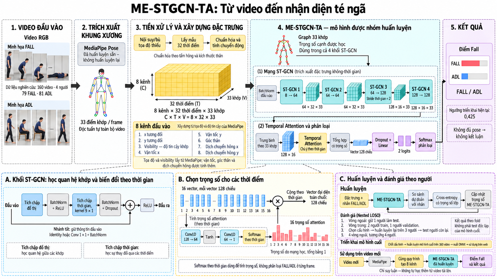
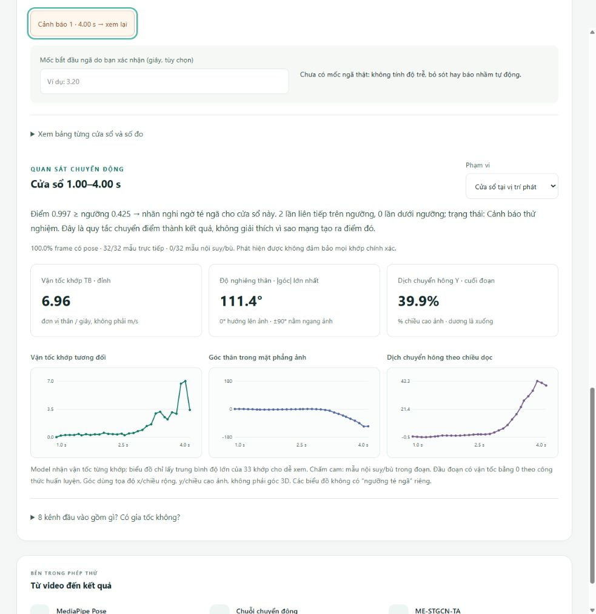
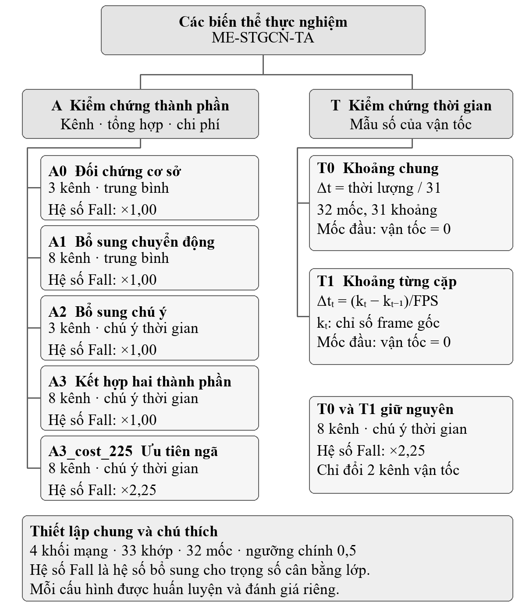

# 🛡️ ME-STGCN-TA — Phát hiện té ngã từ khung xương

Dự án phân loại **té ngã (Fall)** và **hoạt động thường ngày (ADL)** từ video một người. MediaPipe trích xuất tư thế; ME-STGCN-TA học quan hệ không gian–thời gian từ khung xương và đặc trưng chuyển động. Ứng dụng **PoseLab** cho phép xem video, khung xương, điểm Fall, dữ liệu chuyển động và lịch sử cảnh báo.


[Báo cáo Word](docs/bao-cao.docx) · [Phương pháp](docs/methodology.md) · [Notebooks](docs/notebook-guide.md) · [Chạy ứng dụng](app/README.md) · [Hướng nghiên cứu tiếp](docs/training-roadmap.md)

## 🧠 Phương pháp



Video → MediaPipe Pose → xử lý thiếu tư thế → lấy 32 mốc gần đều → 33 khớp → 8 kênh đầu vào → các khối ST-GCN → chú ý thời gian → phân loại Fall/ADL.

Tám kênh gồm tọa độ tương đối x/y, visibility, vận tốc khớp x/y, góc thân và dịch chuyển tâm hông x/y. Đây là biểu diễn đầu vào; mạng tiếp tục học các biểu diễn bên trong. Vận tốc dùng tọa độ chuẩn hóa, không có đơn vị m/s.

## 🖥️ Chạy PoseLab

**Windows, Python 3.11:**

```powershell
.\app\start.cmd
```


Mở **http://127.0.0.1:8765**. Lần đầu cần Internet để cài thư viện và tải Pose Landmarker. Mô hình ONNX và cấu hình đã nằm trong [models/deployment](models/deployment/); không cần dữ liệu huấn luyện để chạy ứng dụng.

Nếu cổng đã được sử dụng:

```powershell
powershell -ExecutionPolicy Bypass -File .\app\start.ps1 -Port 8766
```


Ứng dụng hỗ trợ phân tích một video, cửa sổ trượt, dữ liệu chuyển động, lịch sử sự kiện và đánh giá nhiều video. Video được xử lý trên máy. Telegram chưa được tích hợp; cửa sổ trượt trên file chưa phải kiểm chứng giám sát camera trực tiếp.



## 📓 Notebooks

| Notebook | Chức năng |
|---|---|
| [01 · Chuẩn bị dữ liệu](notebooks/01-prepare-pose-data.ipynb) | Trích xuất pose, tạo đặc trưng và thông tin chia tập |
| [02 · Baseline Motion-SVM](notebooks/02-baseline-motion-svm.ipynb) | Phân loại từ thống kê chuyển động |
| [03 · Baseline ST-GCN](notebooks/03-baseline-stgcn.ipynb) | Học từ ba kênh khung xương cơ sở |
| [06 · Mô hình triển khai](notebooks/06-final-model-nested-loso.ipynb) | Hiệu chỉnh góc thân, nested LOSO, huấn luyện toàn dữ liệu và xuất ONNX |
| [07 · Kiểm chứng thành phần](notebooks/07-component-ablation.ipynb) | So sánh đặc trưng, chú ý thời gian và chi phí lớp ngã |
| [08 · Kiểm chứng thời gian](notebooks/08-timing-ablation.ipynb) | So sánh hai cách tính khoảng thời gian của vận tốc |

<details>
<summary>Các giai đoạn ban đầu: 04, 04b và 05</summary>

- [04 · ME-STGCN-TA ban đầu](notebooks/history/04-proposed-me-stgcn-ta.ipynb).
- [04b · Điều chỉnh ưu tiên độ nhạy](notebooks/history/04b-sensitivity-tuning.ipynb).
- [05 · Huấn luyện và xuất mô hình ban đầu](notebooks/history/05-initial-model-export.ipynb).

Các bản này lưu lịch sử phương pháp, không phải các bước bắt buộc trước 06–08. Mô hình của bản 05 không phải mô hình ứng dụng đang sử dụng.

</details>

[Hướng dẫn Kaggle](docs/notebook-guide.md) ghi rõ input, GPU, cách chạy và lưu phiên bản. [data/README.md](data/README.md) mô tả bốn tệp đầu vào; video và tensor dữ liệu không được đóng gói trong repo.

## 📊 Kết quả đã đo

Thí nghiệm dùng **160 video, 79 Fall, 81 ADL và bốn chủ thể**. Với kiểm chứng thành phần và thời gian, số liệu dưới đây là trung bình ba seed tại ngưỡng cố định 0,5. Ba seed không tạo thành 480 video độc lập.

| Cấu hình | Accuracy ± SD (%) | Sensitivity (%) | Specificity (%) |
|---|---:|---:|---:|
| A0 · 3 kênh, trung bình | 84,58 ± 4,73 | 85,65 | 83,54 |
| A1 · 8 kênh, trung bình | 89,38 ± 1,08 | 91,14 | 87,65 |
| A2 · 3 kênh, chú ý | 87,71 ± 0,72 | 93,25 | 82,30 |
| A3 · 8 kênh, chú ý | 89,58 ± 3,44 | 91,98 | 87,24 |
| A3 · Tăng chi phí lớp ngã ×2,25 | 89,58 ± 0,36 | **96,62** | 82,72 |
| T0 · Khoảng thời gian chung | 89,58 ± 0,36 | 96,62 | 82,72 |
| T1 · Khoảng thời gian từng cặp | 87,71 ± 2,60 | 94,09 | 81,48 |

<details>
<summary>Xem sơ đồ cây các cấu hình A0–A3 và T0–T1</summary>



</details>

**Không có accuracy trung bình 95%.** Tăng chi phí lớp ngã giảm bỏ sót nhưng tăng báo nhầm; T1 chưa cải thiện ổn định. Các nhánh là phép kiểm chứng, không phải chuỗi nâng cấp mà mỗi bước chắc chắn tốt hơn.

- [Kiểm chứng thành phần](docs/component-ablation.md) · [Dự đoán và kết quả gốc](results/component_ablation/README.md).
- [Kiểm chứng thời gian](docs/timing-ablation.md) · [Dự đoán và kết quả gốc](results/timing_ablation/README.md).
- [Đánh giá mô hình triển khai](results/deployment_evaluation/README.md): accuracy 87,50%, sensitivity 100%, specificity 75,31% thuộc mô hình theo fold, **không phải test độc lập của mô hình đã học toàn bộ 160 video**.
- [Thử nghiệm video ngoài](results/external_evaluation/README.md) và [thời gian xử lý](results/benchmark/README.md) được báo cáo riêng.

## 🗂️ Cấu trúc repo

```text
app/                         Ứng dụng phân tích video và cảnh báo
models/deployment/           Mô hình dùng trong ứng dụng
notebooks/                   Các bước chuẩn bị, baseline và kiểm chứng
notebooks/history/           Giai đoạn đề xuất và xuất mô hình ban đầu
training/component_ablation/ Mã kiểm chứng thành phần
results/                     Dự đoán, bảng kết quả và cấu hình thực nghiệm
docs/                        Một báo cáo Word, đề cương và ảnh minh họa
scripts/                     Kiểm tra repo và tạo biểu đồ
data/README.md               Hướng dẫn dữ liệu đầu vào
```


[Báo cáo hiện tại](docs/bao-cao.docx) đang hoàn thiện; các mục chưa có bằng chứng được để trống. Repo chỉ giữ một bản Word để cập nhật tại cùng đường dẫn; các phiên bản đã commit có thể xem trong lịch sử Git. [Đề cương ban đầu](docs/de-cuong.pdf) được giữ dưới dạng PDF.

Kiểm tra tính toàn vẹn của mô hình, notebooks, kết quả và liên kết:

```bash
python scripts/check_repository.py
```


## Phạm vi sử dụng

Ứng dụng là bản thử nghiệm nghiên cứu, chưa được kiểm chứng như thiết bị y tế hoặc hệ thống cấp cứu. Kết quả phát triển trên bốn người không bảo đảm hiệu quả cho mọi người và mọi cảnh quay. Mã nguồn, dữ liệu và thư viện có điều kiện sử dụng riêng; xem [NOTICE](NOTICE.md).
