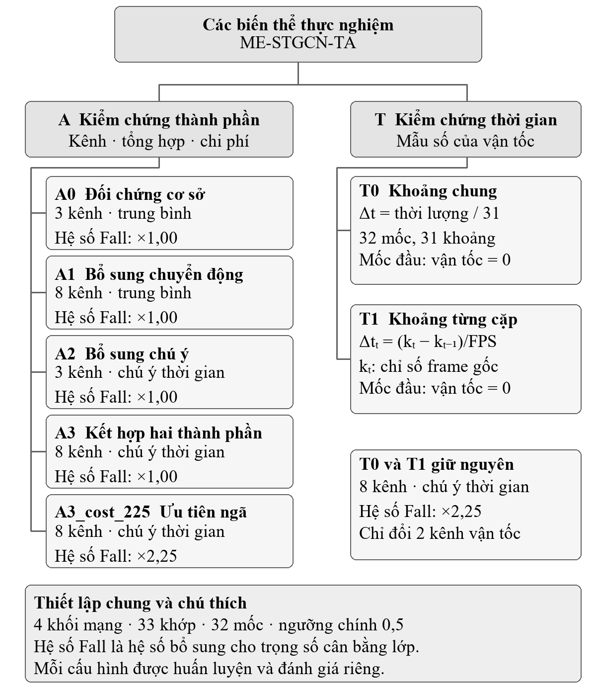

# 🛡️ ME-STGCN-TA — Phát hiện té ngã từ khung xương

**Cập nhật 20/11/2026:** đã nghiệm thu và merge [PR #2 của Tùng](https://github.com/aBaoN9/me-stgcn-ta-fall-detection/pull/2): **TCN so với A3**, đủ code, 24 checkpoint và kết quả full trên dữ liệu thật. TCN đạt Accuracy trung bình **91,04%**, A3 đối chứng chạy lại **89,38%**; đây là benchmark nghiên cứu, **không thay model triển khai**. Quyết định `GB-20261120-001` trong [answers](docs/discussions/answers.md).

**Bắt đầu làm bài:** [hướng dẫn local/Kaggle, tool kiểm/tải input và checklist](docs/training-start.md). Quyền tự chủ và lựa chọn CPU theo `GB-20261119-002` vẫn giữ; tự khóa thay đổi trước outer-test, không chờ duyệt từng bước. Quyền CPU không tự mở chế độ CPU full của runner còn khóa CUDA.

Dự án nghiên cứu phân loại **té ngã (Fall)** và **hoạt động thường ngày (ADL)** từ video một người. MediaPipe trích xuất tư thế; ME-STGCN-TA học quan hệ không gian–thời gian từ khung xương và đặc trưng chuyển động. **PoseLab đã dừng theo quyết định của Gia Bảo ngày 30/10/2026**; repo tập trung so sánh phương pháp và kiểm chứng thay đổi có kiểm soát.


[Báo cáo Word](docs/bao-cao.docx) · [Phương pháp](docs/methodology.md) · [Benchmark TCN–A3](docs/research/backbone-benchmark.md) · [Notebooks](docs/notebook-guide.md) · [Phân công nghiên cứu](docs/tasks/README.md) · [Hướng nghiên cứu tiếp](docs/training-roadmap.md)

## Thành viên và AI bắt đầu ở đây

**Quy định hiện hành 18/11/2026 — `GB-20261118-001` (Tùng), `GB-20261116-002` (Đức):** Cả hai tự chọn phương án trong nhiệm vụ, triển khai, kiểm tra, smoke và full train khi đủ điều kiện; không chờ Gia Bảo duyệt M0, mô hình/kiến trúc, cấu hình, thiết bị hoặc review lại bản sửa trước chạy. Tùng được bắt đầu TCN so với A3 từ M0 đã nộp, tự điều chỉnh hoặc dùng dự phòng trước outer-test có ghi lý do. M0 phải được ghi/khóa trước outer-test; dữ liệu, split, seed và đánh giá chung không đổi; test và smoke thật phải PASS. Được commit/push sản phẩm đúng phạm vi lên nhánh cá nhân, upload artifact và mở PR, không xin lại từng lần. Review cuối vẫn quyết định nghiệm thu/merge main. Xem [quyết định chính thức](docs/discussions/answers.md).

Đọc [AGENTS.md](AGENTS.md) -> [bàn giao](docs/handoff.md) -> [nhiệm vụ](docs/tasks/README.md) -> [giao thức nghiên cứu](docs/research-protocol.md) trước khi sửa. **AI chưa biết người đang làm phải hỏi tên**, không đoán từ tài khoản Git.

| Thành viên | Nhánh | Nhiệm vụ và trạng thái nghiệm thu | Báo cáo |
|---|---|---|---|
| Tùng | `dinhtung` | [TCN–A3: đã nghiệm thu M0–M3, PR #2 đã merge ngày 20/11](docs/tasks/dinhtung.md) | [Tiến độ Tùng](docs/reports/dinhtung.md) |
| Đức | `vinhduc` | [Tiếp tục thay đổi có kiểm soát ME-STGCN-TA; chưa có kết quả mới được nghiệm thu trên main](docs/tasks/vinhduc.md) | [Tiến độ Đức](docs/reports/vinhduc.md) |
| Gia Bảo (người điều phối) | `giabao` | [Phát triển kỹ thuật, chuẩn bị tích hợp và điều phối](docs/tasks/giabao.md) | [Tiến độ Gia Bảo](docs/reports/giabao.md) |

`main` là bản chuẩn đã duyệt của nhóm, không phải nhánh thử nghiệm của Gia Bảo. Gia Bảo sửa code trên `giabao`, review/kiểm tra rồi mới tích hợp khi được yêu cầu; quy tắc và quyết định chung vẫn publish trên `main` để Tùng/Đức cùng đọc.

Phân công ngày **30/10/2026** thay việc chỉ định sẵn CTR-GCN/quality-aware: hai bạn tự đề xuất phương án, giải thích giữ nguyên/thay đổi gì và vì sao, cả hai tự ghi/khóa M0 và tự kiểm đủ điều kiện theo `GB-20261118-001` (Tùng) và `GB-20261116-002` (Đức), không chờ duyệt trước full. Giữ cùng dataset và giao thức đánh giá, không coi là cải tiến đã chứng minh hoặc giao lại 07/08 như chưa làm. Giữ bài làm/review đã có; tiến độ xem báo cáo cá nhân. Không push trực tiếp main; xem [quy trình Git và input](docs/handoff.md).

**Mốc của Đức:** `A3_motion_attention` / policy `fixed` của notebook 07, tám kênh, attention bật, Fall multiplier 1.0; không phải model demo 06 hoặc A3_cost_225. [Nhiệm vụ Đức](docs/tasks/vinhduc.md) chỉ rõ mã, recipe và cách đối chiếu bản gốc.

**PoseLab và WEB-01/WEB-02 đã hủy**, không còn việc UI/QA khi rảnh hoặc chờ GPU. **Hỏi nhóm qua Markdown:** cập nhật cùng [file trao đổi cá nhân](docs/discussions/README.md), commit/push lên nhánh mình mỗi lần hỏi; người điều phối kiểm và trả lời trong [answers.md](docs/discussions/answers.md) trên main. Ghi đè nội dung file bằng commit mới, không force-push.

Câu khởi động có thể gửi AI sau clone:

> Đọc AGENTS.md, docs/handoff.md và quyết định GB-20261118-001 (Tùng) và GB-20261116-002 (Đức) trong docs/discussions/answers.md. Cả hai tự ghi/khóa M0, triển khai, kiểm test/smoke thật rồi full và nộp model/kết quả trên nhánh mình; không chờ Gia Bảo duyệt từng bước. Tùng được bắt đầu từ M0 TCN đã nộp, tự điều chỉnh hoặc dùng dự phòng trước outer-test có ghi lý do. Chưa biết tôi là ai thì hỏi tên trước khi sửa. Tùng dùng mô hình/phương pháp khác trên cùng dataset; Đức thay đổi có kiểm soát mô hình hiện tại. Tự đề xuất và giải thích, không áp sẵn cách làm; giữ cùng giao thức đánh giá. PoseLab đã dừng, không làm web. Kiểm tra nhánh/phạm vi, cập nhật báo cáo mỗi phiên; hỏi nhóm qua file trao đổi Markdown cá nhân và đọc trả lời trên main. Không bịa kết quả hoặc tự thay model gốc.

## 🧠 Phương pháp


Video → MediaPipe Pose → xử lý thiếu tư thế → lấy 32 mốc gần đều → 33 khớp → 8 kênh đầu vào → các khối ST-GCN → chú ý thời gian → phân loại Fall/ADL.

Tám kênh gồm tọa độ tương đối x/y, visibility, vận tốc khớp x/y, góc thân và dịch chuyển tâm hông x/y. Đây là biểu diễn đầu vào; mạng tiếp tục học các biểu diễn bên trong. Vận tốc dùng tọa độ chuẩn hóa, không có đơn vị m/s.

**Đối chứng mới của Tùng:** TCN viết tắt của **Temporal Convolutional Network** (mạng tích chập theo thời gian). `TCN_v2_small` dùng cùng tám kênh v2 và 32 mốc/33 khớp, ghép thành 264 kênh chuỗi; bốn khối residual tích chập nhân quả, hidden 32, dilation 1/2/4/8 và phân loại từ biểu diễn cuối chuỗi. Khác A3 ở cả mạng học biểu diễn và cách tổng hợp; đây là so sánh hai phương pháp, không cô lập tác dụng riêng graph hay attention. Xem [mã mô hình](training/backbone_benchmark/models.py) và [thiết kế/nguồn/adaptation](docs/research/backbone-benchmark.md).

## Trạng thái demo cũ

PoseLab **đã tắt**, không còn hướng dẫn khởi chạy hoặc nhiệm vụ phát triển web. Launcher và khởi động ASGI bị chặn. Nguồn `app/`, [model/checkpoint cũ](models/deployment/) và kết quả được giữ để truy vết nghiên cứu, không xóa dữ liệu lịch sử. Xem [quyết định dừng](docs/tasks/web-app.md).

## 📓 Notebooks

| Notebook | Chức năng |
|---|---|
| [01 · Chuẩn bị dữ liệu](notebooks/01-prepare-pose-data.ipynb) | Trích xuất pose, tạo đặc trưng và thông tin chia tập |
| [02 · Baseline Motion-SVM](notebooks/02-baseline-motion-svm.ipynb) | Phân loại từ thống kê chuyển động |
| [03 · Baseline ST-GCN](notebooks/03-baseline-stgcn.ipynb) | Học từ ba kênh khung xương cơ sở |
| [06 · Mô hình triển khai](notebooks/06-final-model-nested-loso.ipynb) | Hiệu chỉnh góc thân, nested LOSO, huấn luyện toàn dữ liệu và xuất ONNX |
| [07 · Kiểm chứng thành phần](notebooks/07-component-ablation.ipynb) | So sánh đặc trưng, chú ý thời gian và chi phí lớp ngã |
| [08 · Kiểm chứng thời gian](notebooks/08-timing-ablation.ipynb) | So sánh hai cách tính khoảng thời gian của vận tốc |

<details>
<summary>Các giai đoạn ban đầu: 04, 04b và 05</summary>

- [04 · ME-STGCN-TA ban đầu](notebooks/history/04-proposed-me-stgcn-ta.ipynb).
- [04b · Điều chỉnh ưu tiên độ nhạy](notebooks/history/04b-sensitivity-tuning.ipynb).
- [05 · Huấn luyện và xuất mô hình ban đầu](notebooks/history/05-initial-model-export.ipynb).

Các bản này lưu lịch sử phương pháp, không phải các bước bắt buộc trước 06–08. Mô hình bản 05 khác checkpoint 06 được lưu trong `models/deployment/`; PoseLab hiện đã dừng.

</details>

[Hướng dẫn Kaggle](docs/notebook-guide.md) ghi rõ input, GPU, cách chạy và lưu phiên bản. **Bốn input chuẩn đã có trên main từ 19/11/2026** trong [data/gmdcsa24/](data/gmdcsa24/); dùng `--input-root data/gmdcsa24`, xem [hướng dẫn/hash/nguồn](data/README.md). Không cần chờ gửi riêng hoặc chạy lại notebook 01. Video gốc và dữ liệu riêng khác không được đóng gói trong repo.

## 📊 Kết quả đã đo

### Benchmark mới đã nghiệm thu: TCN so với A3

[Bộ bàn giao](results/backbone_benchmark/tung-m2-rtx3050-20261120-165523/README.md) chạy trên **RTX 3050 Laptop GPU**, code train `12eaf80`, cùng bốn input chuẩn của 07. Cả hai được train lại trong cùng run, không lấy số lịch sử của A3 làm đối chứng. Giao thức: **4 outer subject × 3 inner subject**, ba seed **42/142/242**; chọn epoch/ngưỡng bằng inner validation rồi refit trên outer-train, không dùng outer-test để chọn. Tổng **72 inner fits + 24 refits = 96 fits**, lưu **24 checkpoint**.

Kết quả chính dưới đây là ngưỡng cố định **0,5**, trung bình ± độ lệch chuẩn mẫu qua ba seed; Sensitivity là tỷ lệ phát hiện đúng Fall, Specificity là tỷ lệ nhận đúng ADL:

| Mô hình | Accuracy ± SD (%) | Sensitivity ± SD (%) | Specificity ± SD (%) | F1 ± SD (%) |
|---|---:|---:|---:|---:|
| A3 · ME-STGCN-TA chạy lại | 89,38 ± 2,50 | 92,41 ± 2,53 | 86,42 ± 2,47 | 89,57 ± 2,45 |
| TCN_v2_small | **91,04 ± 0,72** | **94,09 ± 2,64** | **88,07 ± 2,57** | **91,20 ± 0,75** |

TCN tăng trung bình **1,67 điểm phần trăm Accuracy**, nhưng không thắng mọi seed:

| Seed | A3 Accuracy (%) | TCN Accuracy (%) | TCN − A3 (điểm phần trăm) |
|---|---:|---:|---:|
| 42 | 86,88 | 91,88 | +5,00 |
| 142 | 89,38 | 90,63 | +1,25 |
| 242 | **91,88** | 90,63 | −1,25 |

| Chi phí mô hình | A3 chạy lại | TCN_v2_small |
|---|---:|---:|
| Số tham số | 422.871 | **56.434** |
| Kích thước một checkpoint (byte) | 1.742.362 | **237.298** |
| Suy luận trung vị / p95 (ms) | 3,331 / 4,238 | **2,850 / 3,034** |

TCN ít hơn **86,65% tham số**. Latency do Tùng đo riêng trên RTX 3050, batch 1, checkpoint seed 42/subject 1, clip `S1_ADL_01`, 30 lượt warmup và 200 lượt đo. Đây là thời gian **model-only**, không gồm video/MediaPipe/preprocessing, không phải benchmark end-to-end hoặc mọi checkpoint. Chi tiết ở [bảng latency](results/backbone_benchmark/tung-m2-rtx3050-20261120-165523/m3_model_latency.csv).

**Bằng chứng và giới hạn:**

- [2.880 dòng dự đoán](results/backbone_benchmark/tung-m2-rtx3050-20261120-165523/predictions.csv) = 160 video × 2 mô hình × 3 seed × 3 chính sách ngưỡng (`fixed`, `balanced`, `sensitivity`), **không phải 2.880 video độc lập**. Chính sách chính là `fixed`; hai chính sách còn lại xem toàn bộ trong [phân tích](docs/research/backbone-benchmark.md).
- Đối chiếu độc lập: **68 hash đúng**, code/input lock khớp, đủ lịch sử 96 fits và chia subject không giao nhau; tái tính metric từ raw OOF đúng. Nạp **24/24 checkpoint** và suy luận lại bằng CPU cho cùng toàn bộ 2.880 quyết định. Review dùng Torch 2.11.0+cpu, khác môi trường train Torch 2.10.0+cu126; score không khớp bit tuyệt đối (sai lệch tối đa khoảng 0,000508), không gọi đây là tái lập CUDA nguyên trạng hay train lại.
- TCN bỏ sót `S1_FALL_13`, `S2_FALL_14`, `S4_FALL_03` ở cả ba seed; A3 bỏ sót `S4_FALL_05` ở cả ba seed, tại chính sách `fixed`. Xem [lỗi fixed](results/backbone_benchmark/tung-m2-rtx3050-20261120-165523/fixed_error_cases.csv), [toàn bộ lỗi](results/backbone_benchmark/tung-m2-rtx3050-20261120-165523/errors.csv), [manifest checkpoint](results/backbone_benchmark/tung-m2-rtx3050-20261120-165523/models/manifest.json) và [hash bộ bàn giao](results/backbone_benchmark/tung-m2-rtx3050-20261120-165523/m3_files_sha256.json).
- Chỉ **160 video / 4 người**, các outer fold đã được nhóm xem trong phát triển. Ba seed dùng lại dữ liệu, không chứng minh ý nghĩa thống kê hoặc khả năng tổng quát ngoài thực tế. Không có test độc lập mới, không tự xuất model final học toàn dữ liệu và **không thay checkpoint triển khai 06**.

### Số liệu lịch sử: kiểm chứng thành phần và thời gian (07/08)

Thí nghiệm dùng **160 video, 79 Fall, 81 ADL và bốn chủ thể**. Với kiểm chứng thành phần và thời gian, số liệu dưới đây là trung bình ba seed tại ngưỡng cố định 0,5. Ba seed không tạo thành 480 video độc lập.

Đây là các run cũ, **khác run TCN–A3 vừa nghiệm thu**. Vì vậy A3 lịch sử 89,58% không thay cho A3 chạy lại 89,38% trong phép so sánh TCN; không trộn kết quả giữa run hoặc coi mọi hàng là cùng một thí nghiệm.

| Cấu hình | Accuracy ± SD (%) | Sensitivity (%) | Specificity (%) |
|---|---:|---:|---:|
| A0 · 3 kênh, trung bình | 84,58 ± 4,73 | 85,65 | 83,54 |
| A1 · 8 kênh, trung bình | 89,38 ± 1,08 | 91,14 | 87,65 |
| A2 · 3 kênh, chú ý | 87,71 ± 0,72 | 93,25 | 82,30 |
| A3 · 8 kênh, chú ý | 89,58 ± 3,44 | 91,98 | 87,24 |
| A3 · Tăng chi phí lớp ngã ×2,25 | 89,58 ± 0,36 | **96,62** | 82,72 |
| T0 · Khoảng thời gian chung | 89,58 ± 0,36 | 96,62 | 82,72 |
| T1 · Khoảng thời gian từng cặp | 87,71 ± 2,60 | 94,09 | 81,48 |

<details>
<summary>Xem sơ đồ cây các cấu hình A0–A3 và T0–T1</summary>



</details>

**Không có accuracy trung bình 95%.** Tăng chi phí lớp ngã giảm bỏ sót nhưng tăng báo nhầm; T1 chưa cải thiện ổn định. Các nhánh là phép kiểm chứng, không phải chuỗi nâng cấp mà mỗi bước chắc chắn tốt hơn.

- [Kiểm chứng thành phần](docs/component-ablation.md) · [Dự đoán và kết quả gốc](results/component_ablation/README.md).
- [Kiểm chứng thời gian](docs/timing-ablation.md) · [Dự đoán và kết quả gốc](results/timing_ablation/README.md).
- [Đánh giá mô hình triển khai](results/deployment_evaluation/README.md): accuracy 87,50%, sensitivity 100%, specificity 75,31% thuộc mô hình theo fold, **không phải test độc lập của mô hình đã học toàn bộ 160 video**.
- [Thử nghiệm video ngoài](results/external_evaluation/README.md) và [thời gian xử lý](results/benchmark/README.md) được báo cáo riêng.

## Chạy và kiểm tra benchmark TCN–A3

Đọc [môi trường và hướng dẫn runner](training/backbone_benchmark/README.md), [requirements chung](training/component_ablation/requirements.txt) và [hướng dẫn bắt đầu](docs/training-start.md). Run đã nộp dùng Python 3.11.9, Torch 2.10.0+cu126/CUDA 12.6, NumPy 2.2.6, pandas 2.3.3, scikit-learn 1.7.2. Dùng môi trường riêng, không cài đè Torch/CUDA hệ thống chỉ để chạy lệnh mẫu.

Từ gốc repo, kiểm dữ liệu và phần mềm trước; kiểm thử dùng dữ liệu tổng hợp, **không tạo kết quả học thuật mới**:

```bash
python scripts/training_inputs.py --input-root data/gmdcsa24
python -B -m training.backbone_benchmark.test_benchmark
python scripts/check_repository.py
```

Nếu thiếu input, thêm `--download` vào lệnh đầu. Muốn kiểm checkpoint/dự đoán đã công bố mà không train lại, làm theo [hướng dẫn bộ bàn giao](results/backbone_benchmark/tung-m2-rtx3050-20261120-165523/README.md). Manifest dùng đường dẫn tương đối với thư mục run; giữ nguyên byte artifact để SHA-256 không đổi.

Chỉ khi **có chủ đích chạy thí nghiệm mới**, dùng CUDA phù hợp và output mới; không chạy ghi đè bộ đã nộp:

```bash
python -B -m training.backbone_benchmark.runner --input-root data/gmdcsa24 --output .runtime/backbone_benchmark/smoke_01 --mode smoke --device cuda
python -B -m training.backbone_benchmark.runner --input-root data/gmdcsa24 --output .runtime/backbone_benchmark/full_01 --mode full --device cuda --smoke-evidence .runtime/backbone_benchmark/smoke_01
```

Runner hiện yêu cầu **smoke dữ liệu thật cùng CUDA/mã/input/môi trường** trước full. Smoke phải đủ 8 fits, reload/coverage PASS, `scientific_result=false`; không dùng smoke hoặc dữ liệu tổng hợp thay kết quả full. `--resume` chỉ dùng khi chữ ký không đổi và có đủ bằng chứng fold; code/input/config/môi trường đổi thì tạo run khác. Full CPU đã được cho phép về điều phối, nhưng **runner Tùng hiện chưa hỗ trợ đường chạy full CPU**; phải tự bổ sung có kiểm tra và khóa addendum trước outer-test, không bỏ guard để ép chạy.

### Hướng nghiên cứu tiếp, không phải điều kiện chặn nghiệm thu

Không cần tìm chỉ số hoặc chọn seed có lợi cho A3 để phủ nhận kết quả TCN. Các hướng có thể kiểm tiếp: độ nhạy ở cùng mức báo động giả (ngưỡng chọn bằng inner validation), độ bền khi pose thiếu/nhiễu, phân tích lỗi cặp theo toàn bộ subject, hoặc phiên bản A3 gọn hơn theo ngân sách công bằng. Đây là **đề xuất chưa thực hiện**, chưa phải bằng chứng A3 tốt hơn. Phân tích bổ sung sau khi đã thấy test phải ghi rõ tính thăm dò; thiết kế thí nghiệm mới cần khóa trước đánh giá và tập xác nhận độc lập nếu có điều kiện. Xem [roadmap](docs/training-roadmap.md).

## 🗂️ Cấu trúc repo

```text
app/                         Nguồn demo PoseLab cũ, đã tắt
models/deployment/           Checkpoint và cấu hình cũ được bảo toàn
notebooks/                   Các bước chuẩn bị, baseline và kiểm chứng
notebooks/history/           Giai đoạn đề xuất và xuất mô hình ban đầu
training/component_ablation/ Mã kiểm chứng thành phần
training/backbone_benchmark/ TCN–A3, runner và kiểm thử của Tùng đã nghiệm thu
results/backbone_benchmark/  Checkpoint, dự đoán, lock và phân tích TCN–A3
results/                     Dự đoán, bảng kết quả và cấu hình thực nghiệm
docs/                        Một báo cáo Word, đề cương và ảnh minh họa
docs/tasks/                  Nhiệm vụ Tùng/Đức và phạm vi sửa code
docs/reports/                Tiến độ và bằng chứng bàn giao từng người
docs/discussions/            Hỏi-đáp nhóm qua Markdown trên từng nhánh
AGENTS.md                    Quy tắc cho AI khi nhận việc
scripts/                     Kiểm tra repo, kiểm/tải input và tạo biểu đồ
data/gmdcsa24/               Bốn input chuẩn đúng hash và manifest nguồn
```


[Báo cáo hiện tại](docs/bao-cao.docx) đang hoàn thiện; các mục chưa có bằng chứng được để trống. **Phiên tích hợp 20/11 chỉ cập nhật code/kết quả và tài liệu Markdown; chưa đưa kết quả TCN mới vào Word.** Repo chỉ giữ một bản Word để cập nhật tại cùng đường dẫn; các phiên bản đã commit có thể xem trong lịch sử Git. [Đề cương ban đầu](docs/de-cuong.pdf) được giữ dưới dạng PDF.

Kiểm tra tính toàn vẹn của mô hình, notebooks, kết quả và liên kết:

```bash
python scripts/check_repository.py
```


## Phạm vi sử dụng

Ứng dụng là bản thử nghiệm nghiên cứu, chưa được kiểm chứng như thiết bị y tế hoặc hệ thống cấp cứu. Kết quả phát triển trên bốn người không bảo đảm hiệu quả cho mọi người và mọi cảnh quay. Mã nguồn, dữ liệu và thư viện có điều kiện sử dụng riêng; xem [NOTICE](NOTICE.md).
