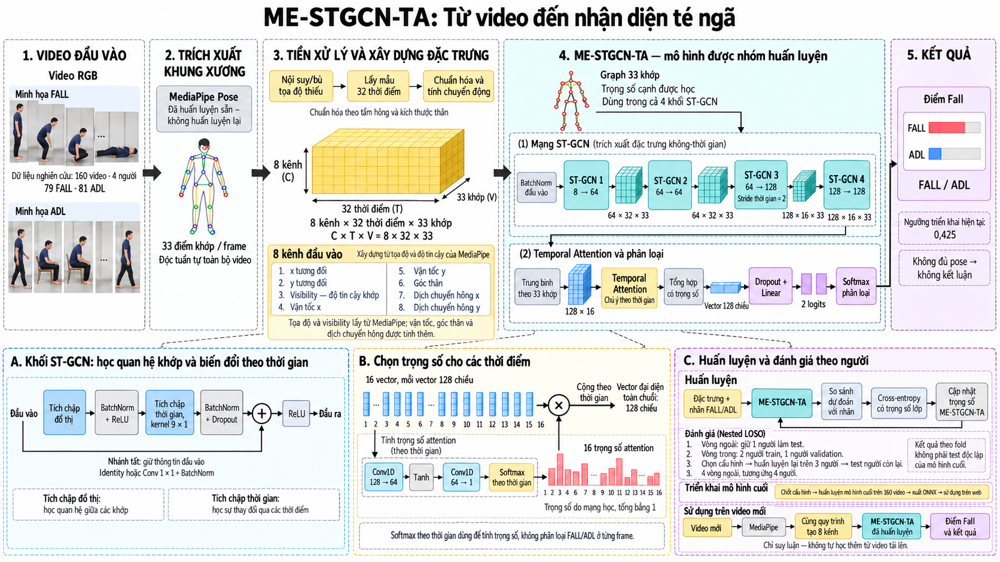

# ME-STGCN-TA — Phát hiện té ngã từ khung xương

Dự án nghiên cứu phân loại **Fall/ADL** từ video một người, kết hợp MediaPipe Pose, đặc trưng chuyển động và mạng không gian–thời gian. Repo có mã tái lập, checkpoint, bằng chứng đánh giá và **FallScope**, prototype Streamlit để xem video cùng tín hiệu mô hình.

README mô tả **hiện trạng được tích hợp trên main**, không phải nhật ký theo ngày. Các bản cập nhật trước, quyết định và số đo cũ nằm trong [nhật ký](docs/nhat-ky/README.md); không dùng số liệu lịch sử thay cho bảng hiện hành.

[Chạy demo](#chạy-fallscope) · [Kết quả hiện hành](#kết-quả-benchmark-hiện-hành) · [Dữ liệu](data/README.md) · [Phương pháp](docs/methodology.md) · [Báo cáo Word](docs/bao-cao.docx) · [Nhật ký](docs/nhat-ky/README.md)

## Hiện trạng

- **Năm model nghiên cứu đã nghiệm thu:** ME-STGCN-TA A3, TCN small v2, GRU small v2, CTR-GCN adapted và SkateFormer adapted small; có đủ 60 checkpoint fold và dự đoán để kiểm tra lại.
- **FallScope chạy local:** upload/phát video, skeleton, chuyển model, biểu đồ đồng bộ, tóm tắt/xuất báo cáo, tiến độ/hủy và lịch sử chỉ lưu khi người dùng chọn. Chưa triển khai công khai.
- **Hai baseline:** Motion-SVM và ST-GCN ba kênh có notebook lịch sử, nhưng chưa có checkpoint đã kiểm chứng cho demo; xuất hiện đầu danh sách và chưa cho suy luận.
- **Tuning A3 là track riêng:** runner/Kaggle trên `giabao` và bộ lưu local PARTIAL chưa được tích hợp/nghiệm thu trên main; thiếu weights/raw OOF nên không dùng để suy luận hoặc thay kết quả đã nhận.
- **Deployment được giữ nguyên:** demo dùng checkpoint nghiên cứu, không thay model/threshold trong `models/deployment/`. PoseLab đã gỡ; không khôi phục app cũ hoặc giao lại WEB-01/WEB-02.

## Phương pháp và dữ liệu



Video → MediaPipe Pose → mask/chuẩn hóa tư thế → 32 mốc thời gian, 33 khớp → đặc trưng v2 tám kênh → backbone → phân loại Fall/ADL. ME-STGCN-TA dùng các khối ST-GCN và chú ý thời gian; các backbone đối chứng dùng cùng dữ liệu và giao thức so sánh.

- **GMDCSA-24:** 160 clip, bốn subject, 79 Fall và 81 ADL. [Bốn input chuẩn và manifest](data/README.md) đã có trong repo; không cần video gốc để replay benchmark.
- **Nested LOSO:** bốn outer folds theo subject; chọn epoch/cấu hình/ngưỡng qua inner validation, không chọn bằng outer-test. Ba seed cố định: 42, 142, 242.
- **Bảng chính dùng ngưỡng 0,5 (`fixed`)**; báo cáo trung bình ± độ lệch chuẩn mẫu qua ba seed trên cùng 160 clip. Không gọi các lần lặp là 480 video độc lập.
- Mốc A3 nghiên cứu là `A3_motion_attention` của notebook 07, không đồng nhất với model triển khai từ notebook 06 hoặc biến thể cost-sensitive.

Chi tiết: [giao thức](docs/research-protocol.md), [kiểm chứng thành phần](docs/component-ablation.md), [kiểm chứng thời gian](docs/timing-ablation.md), [nguồn và điều kiện sử dụng](NOTICE.md).

## Kết quả benchmark hiện hành

Nguồn tổng hợp: [so sánh năm model](results/backbone_benchmark/tung-skate-rtx3050-20261122-205954/comparison/comparison_fixed_mean_std.csv). Đơn vị các tỷ lệ là **%**, ghi mean ± SD; latency là **ms** từ lượt đo chung mới nhất cho cả năm model, không trộn các lượt đo cũ.

| Mô hình | Accuracy ± SD | Sensitivity ± SD | Specificity ± SD | F1 ± SD | GPU median forward |
|---|---:|---:|---:|---:|---:|
| ME-STGCN-TA · A3 | 89,38 ± 2,50 | 92,41 ± 2,53 | 86,42 ± 2,47 | 89,57 ± 2,45 | 4,006 |
| TCN · Small v2 | 91,04 ± 0,72 | 94,09 ± 2,64 | 88,07 ± 2,57 | 91,20 ± 0,75 | 3,494 |
| GRU · Small v2 | 89,58 ± 1,57 | 91,14 ± 2,19 | 88,07 ± 1,89 | 89,62 ± 1,60 | 0,700 |
| CTR-GCN · Adapted | 88,54 ± 2,01 | 89,03 ± 1,46 | 88,07 ± 2,57 | 88,48 ± 1,95 | 5,058 |
| SkateFormer · Adapted small | 84,17 ± 1,30 | 84,81 ± 5,06 | 83,54 ± 2,57 | 84,05 ± 1,87 | 6,772 |

- **TCN** cao nhất về Accuracy, Sensitivity và F1 trung bình trong bảng; không cần chọn chỉ số/seed có lợi để phủ nhận kết quả này.
- **GRU** nhanh nhất trong phép đo forward chung. A3 có Sensitivity cao hơn GRU nhưng chậm hơn; thắng một chỉ số không đồng nghĩa thắng mọi mặt.
- **SkateFormer adapted small** có 22.820 tham số so với A3 422.871, nhưng Accuracy/Sensitivity thấp hơn và forward chậm hơn. Đây là kết quả nghiên cứu bổ sung âm hợp lệ, không phải lý do bắt train lại hoặc đổi model triển khai.
- **CTR-GCN và SkateFormer là các adaptation**, không phải tái lập đầy đủ kiến trúc/kết quả trong paper gốc.

[Chi tiết latency/parameters](results/backbone_benchmark/tung-skate-rtx3050-20261122-205954/comparison/comparison_latency.csv): RTX 3050 Laptop GPU, batch 1, seed 42/subject 1, 30 warm-up và 200 lần đo. Đây là **model-only**, không gồm MediaPipe, decode, tạo feature, truyền dữ liệu hoặc UI; không so trực tiếp với CPU/end-to-end trên demo. Các số GPU là phép đo đã nộp của Tùng, không phải lượt benchmark mới do demo chạy.

### Bằng chứng và tái lập

| Bộ kết quả đã nhận | Full fits mới | Checkpoint full | Mã và hướng dẫn |
|---|---:|---:|---|
| [TCN–A3](results/backbone_benchmark/tung-m2-rtx3050-20261120-165523/README.md) | 96 | 24 | [Runner benchmark](training/backbone_benchmark/README.md) |
| [GRU/CTR-GCN](results/backbone_benchmark/tung-gru-ctr-rtx3050-20261120-233932/README.md) | 96 | 24 | [Runner supplement](training/backbone_benchmark/supplement/README.md) |
| [SkateFormer](results/backbone_benchmark/tung-skate-rtx3050-20261122-205954/README.md) | 48 | 12 | [Runner SkateFormer](training/backbone_benchmark/skate/README.md) |

Các bộ giữ config/code/input hash, checkpoint, split, dự đoán, log và manifest riêng. Bảng năm model tái sử dụng A3/TCN/GRU/CTR-GCN đã nhận, không gọi là train lại đồng thời cả năm. Smoke có checkpoint/bằng chứng riêng, không tính vào fits/checkpoint full hoặc kết quả khoa học.

Notebook [07](notebooks/07-component-ablation.ipynb)/[08](notebooks/08-timing-ablation.ipynb) và kết quả kiểm chứng thành phần/thời gian vẫn được giữ nguyên, nhưng là thí nghiệm khác, không gộp vào bảng backbone trên. Định nghĩa metric và protocol xem [phương pháp](docs/methodology.md).

## Chạy FallScope

Dùng **Python 3.11**, môi trường riêng và PyTorch CPU phù hợp; không cài đè CUDA/PyTorch hệ thống để chạy demo. Chi tiết cài đặt, xác minh asset và giới hạn ở [README FallScope](demo_streamlit/README.md).

```powershell
python -m venv .venv-streamlit
.venv-streamlit/Scripts/python -m pip install -r demo_streamlit/requirements.txt
.venv-streamlit/Scripts/python -m demo_streamlit.prepare_assets
./demo_streamlit/run.ps1
```

Mở `http://127.0.0.1:8501/`. Lệnh chuẩn bị asset tải MediaPipe full v1 và kiểm SHA-256; không tự train hoặc tải weights của model khác để thay thế.

**Thứ tự chọn model:** Motion-SVM · Base → ST-GCN · Base (3 kênh) → ME-STGCN-TA · A3 → TCN · Small v2 → GRU · Small v2 → CTR-GCN · Adapted → SkateFormer · Adapted small. Phiên mới mặc định chọn **A3**; hai baseline đứng đầu nhưng bị khóa suy luận do thiếu checkpoint.

- **Bên trái:** upload video một người, player và skeleton. Giới hạn 60 giây/50 MB; không hỗ trợ mọi kiểu timestamp/codec hoặc theo dõi danh tính nhiều người.
- **Bên phải:** model, Fall score, pose coverage, CPU forward latency và biểu đồ đồng bộ theo timestamp. **Phân tích trước rồi phát**, không phải livestream inference.
- **Điều khiển:** danh sách vùng score cao/ảnh bấm để tua, tiến độ/hủy, tóm tắt phiên và xuất HTML để in PDF, CSV, JSON.
- **Lịch sử opt-in:** chỉ ghi khi bấm lưu; mặc định báo cáo, video/skeleton cần bật riêng. Tối đa 20 phiên/250 MB, mở lại/xóa có xác nhận; SQLite chưa mã hóa/phân quyền nên chỉ dùng localhost.
- **Không có Accuracy live:** Fall score là softmax của cửa sổ, không phải xác suất đã hiệu chuẩn. Benchmark có nhãn hiển thị riêng; chưa xác lập Accuracy, detection delay hoặc false-alarm-rate cho video tải lên/sliding windows.

## Kiểm tra và chạy nghiên cứu

```powershell
python -B -X utf8 scripts/check_repository.py
.venv-streamlit/Scripts/python -B -X utf8 -m unittest discover -s demo_streamlit/tests -v
.venv-streamlit/Scripts/python -B -X utf8 -m unittest -v training.backbone_benchmark.test_benchmark training.backbone_benchmark.supplement.test_supplement training.backbone_benchmark.supplement.tools.test_monitor_windows training.backbone_benchmark.skate.test_skate
```

Checker giữ hash model, chín notebook cũ, một Word, dự đoán/aggregate thành phần–thời gian và liên kết tài liệu. Bộ test demo kiểm thứ tự/switch model, baseline thiếu weights, hash/split, cửa sổ nhân quả, lịch sử/báo cáo/hủy và replay một mẫu held-out qua mỗi checkpoint trong 60 fold. Đây là kiểm tra phần mềm, không thay full train hoặc đánh giá ngoài miền.

Muốn chạy thí nghiệm mới: đọc [bắt đầu local/Kaggle](docs/training-start.md), kiểm bốn input, khóa phương án trước outer-test và làm theo README runner tương ứng. Runner hiện yêu cầu smoke thật cùng code/input/môi trường/CUDA trước full; quyền tự chủ CPU không có nghĩa được bỏ guard CUDA trong runner chưa hỗ trợ CPU full. Không ghi đè artifact đã nghiệm thu, sửa lock hồi tố hoặc normalize byte để né hash.

## Phân công và hướng tiếp theo

| Thành viên | Nhánh | Hiện trạng trên main |
|---|---|---|
| [Tùng](docs/tasks/dinhtung.md) | `dinhtung` | Đã nhận các benchmark cũ; nhiệm vụ mới: train CascadeFormer, DHA-eGCN, Hyper-GCN, ProtoGCN, InfoGCN++; [báo cáo](docs/reports/dinhtung.md) |
| [Đức](docs/tasks/vinhduc.md) | `vinhduc` | Nhiệm vụ mới: train SkateFormer, BlockGCN, DeGCN, JT-GraphFormer, DS-GCN; giữ bài contribution riêng; [báo cáo](docs/reports/vinhduc.md) |
| [Gia Bảo](docs/tasks/giabao.md) | `giabao` | Phát triển/tuning/demo, review và điều phối tích hợp; [báo cáo](docs/reports/giabao.md) |

Theo **GB-20261124-001**, cả hai triển khai và train theo [hướng dẫn mười model](docs/research/modern-model-benchmark.md): cùng input v2 `(N,8,32,33)`, recipe CE, nested LOSO, seed 42/142/242, fixed 0,5, F1 lớp Fall và mean/sample SD với A3. Mỗi người chạy A3 tham chiếu cùng môi trường; **không chờ duyệt từng bước** sau khi tự khóa M0/test/smoke PASS. Đợt mới `ASSIGNED / NOT_RUN`, chưa có runner đủ mười model hoặc kết quả mới; các bản CE-adapted không đồng nghĩa tái lập đầy đủ paper.

Đức được thay backbone trong đợt mới, không bị giới hạn chỉ sửa A3. Nghiệm thu cũ và SkateFormer adapted small được giữ riêng. Hạn bài cũ **25/11/2026 (UTC+7)** không đổi; chưa chốt hạn riêng cho toàn bộ mười model, cần báo tiến độ/ETA/blocker tại mốc đó. Quyền train không đồng nghĩa đã chạy, đã nghiệm thu hoặc được thay dataset/deployment.

Tuning A3 theo [kế hoạch riêng](docs/research/a3-tuning-plan.md): đối chứng TCN/GRU, sáu recipe/model, cùng ngân sách 684 fits thiết kế, chọn bằng inner validation. Bộ lưu local PARTIAL chưa đủ weights/raw predictions/selection; chưa nghiệm thu kết quả tuning trên main và không tuyên bố vượt TCN/GRU. Các hướng pose thiếu/nhiễu, cùng mức báo động giả hoặc A3 gọn hơn trong [roadmap](docs/training-roadmap.md) vẫn là câu hỏi nghiên cứu, không phải lợi thế đã chứng minh.

AI/thành viên bắt đầu từ [AGENTS](AGENTS.md) → [bàn giao](docs/handoff.md) → [nhiệm vụ](docs/tasks/README.md) → [protocol](docs/research-protocol.md). Phát triển trên nhánh được giao; main giữ bản chuẩn đã review. Hỏi nhóm qua [Markdown](docs/discussions/README.md), đọc [quyết định hiện hành](docs/discussions/answers.md); không reset nhánh có bài làm hoặc giao lại việc đã được nhận.

## Cấu trúc và tài liệu

```text
demo_streamlit/               FallScope local, loader, player và test
training/backbone_benchmark/  TCN–A3, supplement GRU/CTR-GCN, skate SkateFormer
training/component_ablation/  Mã kiểm chứng thành phần và thời gian
results/backbone_benchmark/   Ba bộ bàn giao, checkpoint/lock/predictions
results/                     Kết quả thực nghiệm khác được giữ nguyên
data/gmdcsa24/                Bốn input chuẩn và manifest nguồn/hash
models/deployment/           Checkpoint/cấu hình triển khai cũ được bảo toàn
notebooks/                   01/02/03/06/07/08; history/ giữ 04/04b/05
docs/nhat-ky/                Mốc cập nhật cũ và bản lưu README
docs/reports/                Tiến độ/bằng chứng cá nhân
docs/discussions/            Hỏi-đáp và quyết định nhóm
scripts/                     Kiểm repo, kiểm/tải input và tạo biểu đồ
```

[Hướng dẫn notebook](docs/notebook-guide.md) · [Benchmark backbone](docs/research/backbone-benchmark.md) · [Thiết kế GRU/CTR-GCN](docs/research/gru-ctrgcn-addendum.md) · [Thiết kế SkateFormer](docs/research/skateformer-addendum.md) · [Đề cương](docs/de-cuong.pdf)

[Báo cáo Word](docs/bao-cao.docx) vẫn là một bản duy nhất, chưa bổ sung các benchmark backbone mới; không coi cập nhật README/demo là đã cập nhật Word. Các phiên bản Word trước nằm trong lịch sử Git.

## Giới hạn và cách cập nhật

Chỉ bốn subject và các outer folds đã được xem trong phát triển; ba seed không chứng minh ý nghĩa thống kê hoặc khả năng tổng quát. Chưa có tập xác nhận độc lập, chưa kiểm chứng như thiết bị y tế/hệ thống cấp cứu. Demo dùng cửa sổ video khác protocol clip đã benchmark; không dùng để cam kết phát hiện ngã an toàn ngoài thực tế.

Khi có kết quả đã kiểm chứng, **thay nội dung hiện trạng/bảng so sánh tương ứng trong README**, không chèn thêm khối “Cập nhật ngày…” lên đầu. Ghi phần thay đổi, trạng thái cũ, commit/PR/run, bằng chứng và giới hạn vào [nhật ký](docs/nhat-ky/README.md). Không xóa/ghi đè checkpoint hoặc kết quả gốc khi dọn tài liệu; không đưa log/weights chưa được nghiệm thu thành kết quả mới nhất.
