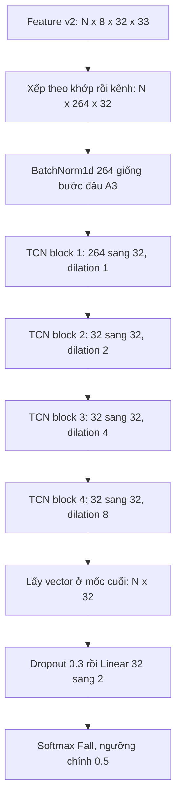

# M0 — Đề xuất TCN đối chứng với ME-STGCN-TA

- Người thực hiện: Nguyễn Đinh Tùng; nhánh `dinhtung`.
- Ngày nghiên cứu: 17/11/2026 (UTC+7).
- Trạng thái hiện hành (19/11/2026): **`M0_DOCUMENTED`** theo `GB-20261118-001` trên origin/main `af9e7fb`. Quyết định mới thay các yêu cầu xin duyệt trong nội dung đề xuất lịch sử dưới đây. Thiết kế thực nghiệm giữ nguyên. Xem [tiến độ M1](../reports/dinhtung.md).
- Phiên này chỉ nghiên cứu và viết tài liệu; chưa triển khai M1, chưa smoke (chạy thử nhỏ), chưa train (huấn luyện), chưa có kết quả mới.
- Tùng đã kiểm tra và đồng ý gửi ngày 17/11/2026. Đây là **đề xuất chính thức xin Gia Bảo xem xét**, được phép commit/push lên `origin/dinhtung`; chưa được Gia Bảo phê duyệt.
- Hạn sản phẩm theo nhóm: **25/11/2026 (UTC+7)**, model đã train + kết quả trên GitHub. M0 không thay thế sản phẩm đó.

## 1. Căn cứ, phiên bản và ranh giới

Đã fetch (cập nhật tham chiếu Git) thành công ngày 17/11. `origin/main` ở `8ab7b29f02da8ee5031387ad99526ac57c22fdc7`; `origin/dinhtung` ở `1ab8164c1c0408e36fe8ac955ce0fbede9f76343`. Đã chuyển an toàn từ main sạch sang local dinhtung theo dõi origin/dinhtung. Khi phát hành M0, đã đồng bộ dinhtung bằng `git merge --ff-only origin/main` tới 8ab7b29; không có xung đột, hash cả ba tài liệu M0 giữ nguyên trước/sau đồng bộ. Không tự chỉnh sửa tài liệu chung.

**Quy định hiện hành:** dinhtung đã nhận tài liệu chung từ origin/main tại commit 8ab7b29. Phân công cũ ép CTR-GCN/B0–B3 hoặc cho QA web không còn áp dụng. Nguồn có phiên bản cố định:

- [AGENTS hiện hành](https://github.com/aBaoN9/me-stgcn-ta-fall-detection/blob/8ab7b29f02da8ee5031387ad99526ac57c22fdc7/AGENTS.md).
- [Nhiệm vụ Tùng](https://github.com/aBaoN9/me-stgcn-ta-fall-detection/blob/8ab7b29f02da8ee5031387ad99526ac57c22fdc7/docs/tasks/dinhtung.md), mục Phạm vi và M0–M3.
- [Giao thức nghiên cứu](https://github.com/aBaoN9/me-stgcn-ta-fall-detection/blob/8ab7b29f02da8ee5031387ad99526ac57c22fdc7/docs/research-protocol.md), mục 3–6.
- [Quyết định GB-20261030-001, GB-20261116-001 và GB-20261116-002](https://github.com/aBaoN9/me-stgcn-ta-fall-detection/blob/8ab7b29f02da8ee5031387ad99526ac57c22fdc7/docs/discussions/answers.md).

Phân công 30/10 cho Tùng chọn mô hình/phương pháp khác trên cùng dữ liệu; không bắt buộc CTR-GCN. Quyết định 16/11 giữ hạn và sản phẩm; quyền tự khóa M0/chạy full (huấn luyện đầy đủ) của GB-20261116-002 **chỉ dành cho Đức**. Tùng cần Gia Bảo duyệt M0 trước full. PoseLab/WEB-01/WEB-02 đã dừng. Chỉ viết ba tài liệu thuộc Tùng; không sửa nguồn chung, model triển khai, kết quả cũ hoặc phần Đức. Chỉ đọc mã/bài báo bên ngoài, không cài hoặc đưa mã bên ngoài vào repo trong M0.

Phiên soạn ban đầu chỉ lưu bản nháp. Trong yêu cầu tiếp theo, Tùng đã đồng ý gửi và cho phép đồng bộ, commit/push đúng ba tài liệu M0 lên dinhtung. Câu `TUNG-20261117-001` chuyển thành đề xuất chính thức `OPEN`; chỉ kết luận đã gửi khi kiểm push thành công, không suy thành Gia Bảo đã đọc hoặc duyệt.

## 2. Hiểu mốc hiện có trước khi chọn phương pháp

Nguồn đã đọc: [models.py](../../training/component_ablation/models.py), [features.py](../../training/component_ablation/features.py), [training.py](../../training/component_ablation/training.py), [notebook 07](../../notebooks/07-component-ablation.ipynb), [cấu hình khóa 07](../../results/component_ablation/locked_protocol.json), [phân tích 07](../component-ablation.md), [phương pháp](../methodology.md), [cấu hình final 06](../../models/deployment/model_config.json). Ba module và notebook/cấu hình liên quan không khác origin/main khi kiểm trong phiên này.

### 2.1 Kiến trúc và đặc trưng

`SkeletonModel` tại models.py dòng 61–79 nhận `(N,8,32,33)`: số clip, số kênh, số mốc thời gian, số khớp. BatchNorm (chuẩn hóa trong mạng, thống kê học từ train) → bốn khối ST-GCN (tích chập đồ thị không gian–thời gian) 8→64→64→128→128; khối ba giảm chiều thời gian 32→16. Trung bình theo khớp → Temporal Attention (trọng số chú ý theo thời gian) → vector 128 → hai logits (điểm lớp chưa chuẩn hóa).

Đồ thị MediaPipe 33 khớp dùng cạnh hai chiều/tự nối, chuẩn hóa bậc, trọng số cạnh được học; cửa sổ tích chập thời gian là 9. Đây là ST-GCN-style (kiểu ST-GCN) giản lược của repo, không khẳng định tái hiện nguyên bản paper (bài báo).

Tám kênh ở features.py dòng 80–104: X/Y tương đối tâm hông chia trung vị độ dài thân, visibility (độ tin cậy khớp), vận tốc X/Y tương đối, góc thân, dịch chuyển hông X/Y so với đầu clip. Ba kênh toàn thân lặp tại 33 khớp. Không trực tiếp dùng Z hoặc gia tốc. Vận tốc chia `duration/31`, không phải m/s. v2 đặt visibility=0 tại mốc thiếu, nhưng tọa độ đã được notebook 01 nội suy trước khi lấy 32 mốc. Không thể phục hồi đầy đủ đoạn mất pose (tư thế) gốc.

Tăng cường chỉ cho train: cắt 26–32 mốc rồi nội suy lại, cập nhật duration (thời lượng), lật/đổi trái phải, nhiễu nhẹ tọa độ, bỏ 1–3 khớp; tính lại đặc trưng sau biến đổi pose. Bỏ khớp chỉ xóa năm kênh cục bộ, không xóa ba kênh toàn thân. Giữ đúng thứ tự và xác suất như features.py dòng 107–130, models.py dòng 90–98 cho cả hai phương pháp.

### 2.2 Các phiên bản không được trộn

| Phiên bản | Đặc điểm | Vai trò trong đề xuất |
|---|---|---|
| A3 chuẩn/07 | Feature v2, 8 kênh, attention, dropout 0.3, Fall multiplier (hệ số phạt thêm lớp ngã) 1.0, fixed (ngưỡng cố định) 0.5 | **Đề xuất chạy lại làm mốc**, cần Gia Bảo xác nhận cho Tùng |
| A3_cost_225/07 | Cùng mạng nhưng Fall multiplier 2.25 | Chỉ bối cảnh về đánh đổi bỏ sót/báo nhầm; không đưa vào cặp chính |
| Final 06 | Tiền xử lý/tăng cường cũ, góc index 9 đã sửa, train toàn 160, hệ số 2.25, ngưỡng 0.425 | Bảo toàn; không dùng checkpoint (trọng số lưu) đã học toàn dữ liệu làm đối chứng OOF |
| T0/T1/08 | Hệ số 2.25; kiểm mẫu số thời gian vận tốc | Không trộn vào thí nghiệm này |

Số **lịch sử**, không phải kết quả Tùng: A3 fixed Accuracy (độ chính xác chung) 89.58±3.44%, Sensitivity (độ nhạy) 91.98%, Specificity (độ đặc hiệu) 87.24%; A3_cost_225 tương ứng 89.58±0.36%, 96.62%, 82.72%. Đã đọc/tổng hợp lại các hàng fixed trong [pooled_by_seed.csv](../../results/component_ablation/pooled_by_seed.csv); không train/nạp lại model để xác minh. Đánh giá theo fold (vòng chia dữ liệu) 06 ghi 87.50%, FN0/FP20, không là test độc lập của final 06.

Ưu điểm mốc: có cấu trúc khớp tường minh, đặc trưng chuyển động, mã và bằng chứng ba seed (giá trị khởi tạo ngẫu nhiên). Hạn chế: bốn người quá ít, nội suy làm mất thông tin thiếu pose, phụ thuộc camera/MediaPipe; attention chưa cải thiện ổn định so với A1; score (điểm dự đoán) chưa hiệu chuẩn. Các outer-test (tập kiểm tra vòng ngoài) đã xem trong phát triển. Không gọi kết quả mới là xác nhận mù hoặc hệ thống an toàn.

## 3. Nguồn nghiên cứu đã kiểm tra

Truy cập ngày 17/11/2026. Chỉ dùng bài gốc, mã tác giả hoặc thư viện chính thức. `git ls-remote` (đọc commit nhánh từ xa) xác minh hai commit nguồn dưới đây; đã mở lại mã TCN và CTR-GCN theo chính commit đó. Chưa clone, chạy hay thẩm định toàn bộ kho bên ngoài.

| ID | Nguồn, mã và phạm vi đã đọc |
|---|---|
| S1 | Bai, Kolter, Koltun (2018), [An Empirical Evaluation of Generic Convolutional and Recurrent Networks for Sequence Modeling](https://arxiv.org/abs/1803.01271), [toàn văn mục 3](https://arxiv.org/html/1803.01271v2). Đây là nghiên cứu chuỗi tổng quát, không phải bằng chứng Fall/GMDCSA-24. |
| S2 | Mã tác giả TCN tại commit `2f8c2b817050206397458dfd1f5a25ce8a32fe65`: [tcn.py](https://github.com/locuslab/TCN/blob/2f8c2b817050206397458dfd1f5a25ce8a32fe65/TCN/tcn.py), [đầu phân loại chuỗi](https://github.com/locuslab/TCN/blob/2f8c2b817050206397458dfd1f5a25ce8a32fe65/TCN/mnist_pixel/model.py), [MIT License](https://github.com/locuslab/TCN/blob/2f8c2b817050206397458dfd1f5a25ce8a32fe65/LICENSE). Đã kiểm TemporalBlock, TemporalConvNet, cắt padding và lấy vị trí cuối. |
| S3 | Cho và cộng sự (2014), [Learning Phrase Representations using RNN Encoder–Decoder](https://arxiv.org/abs/1406.1078): nguồn gốc cơ chế cổng của GRU, không phải nghiên cứu té ngã. |
| S4 | [nn.GRU, PyTorch 2.10](https://docs.pytorch.org/docs/2.10/generated/torch.nn.GRU.html), [mã v2.10.0](https://github.com/pytorch/pytorch/blob/v2.10.0/torch/nn/modules/rnn.py), [giấy phép](https://github.com/pytorch/pytorch/blob/v2.10.0/LICENSE). Mã thư viện tham khảo chính thức; không nhận là bản tái hiện nguyên trạng mô hình dịch máy của Cho. |
| S5 | Chen và cộng sự (ICCV 2021), [Channel-wise Topology Refinement Graph Convolution for Skeleton-Based Action Recognition](https://arxiv.org/abs/2107.12213). |
| S6 | CTR-GCN chính thức tại `e13d7582e281d06711eeecb380a472b278ae1663`: [model](https://github.com/Uason-Chen/CTR-GCN/blob/e13d7582e281d06711eeecb380a472b278ae1663/model/ctrgcn.py), [graph NTU](https://github.com/Uason-Chen/CTR-GCN/blob/e13d7582e281d06711eeecb380a472b278ae1663/graph/ntu_rgb_d.py), [giấy phép CC BY-NC 4.0](https://github.com/Uason-Chen/CTR-GCN/blob/e13d7582e281d06711eeecb380a472b278ae1663/LICENSE). Đã kiểm CTRGC, Model, reshape và cấu hình graph 25 khớp. |

Đề xuất sử dụng TCN dựa trên S1/S2, không sao chép kết quả trên tác vụ khác. Nếu tái sử dụng mã MIT trong M1 phải giữ thông báo tác quyền/giấy phép và ghi thay đổi. PyTorch có điều kiện riêng; dùng thư viện không có nghĩa được đổi giấy phép thư viện. CTR-GCN mang điều kiện phi thương mại, cần xem đầy đủ nếu dùng. Giấy phép mã không tự cấp quyền dataset/trọng số bên thứ ba; không dùng weights bên ngoài trong đề xuất.

## 4. Khảo sát ba phương án khả thi

Nhận định về độ khó, tài nguyên và hạn là **ước tính kỹ thuật từ cấu trúc**, chưa đo tốc độ, bộ nhớ, số tham số hoặc Accuracy trên dữ liệu nhóm.

### 4.1 TCN — Temporal Convolutional Network, mạng tích chập theo thời gian

S1/S2 dùng tích chập nhân quả (không nhìn mốc tương lai tại mỗi vị trí), dilation (giãn khoảng cách lấy mẫu) tăng dần và residual (đường cộng tắt). Nó xử lý chuỗi bằng các bộ lọc thay vì truyền trạng thái tuần tự. Bản tham khảo có hai tích chập/khối và chuẩn hóa trọng số.

Adaptation (điều chỉnh cho bài toán nhóm) dự kiến: cùng đặc trưng 8×33 mỗi thời điểm, xếp thành 264 chiều, TCN nhỏ bốn khối, đầu ra hai lớp cho toàn clip. Không cần nhãn mới, pose liên tục mới, dữ liệu ngoài hoặc pretrain (huấn luyện trước). Không cần graph (đồ thị khớp); quan hệ khớp được trộn qua chiều đặc trưng. Khác A3 cả phần học không gian và tổng hợp thời gian. Độ khó thấp–vừa; phù hợp thử trên một GPU Kaggle theo nhận định, chưa có đo thực tế. Rủi ro: mất ưu tiên cấu trúc xương, nhạy thứ tự khớp, đầu vào nhiều chiều so với số người; vẫn overfitting (học thuộc dữ liệu). Chuỗi ngắn và số kênh ẩn nhỏ giúp giới hạn quy mô thiết kế, không bảo đảm tổng quát hóa.

### 4.2 GRU — Gated Recurrent Unit, mạng hồi tiếp có cổng

S3/S4 mô tả trạng thái nhớ được cập nhật qua từng mốc bằng cổng giữ/quên thông tin. Có thể dùng `(N,32,264)`, một lớp 64 chiều ẩn, một chiều thời gian, trạng thái cuối → dropout → hai lớp. Đây là bộ phân loại clip tự thiết kế bằng nn.GRU, không có decoder (mạng giải mã) dịch máy. Không cần dữ liệu/weights ngoài. Không dùng graph hoặc attention.

Ưu: ít thành phần tự viết, có thực thi thư viện; phù hợp chuỗi 32 mốc. Hạn chế: tính trạng thái tuần tự, phải nén chuỗi vào trạng thái cuối, không có cấu trúc khớp rõ; vẫn có nguy cơ học thuộc bốn người. Độ khó thấp; dự kiến phù hợp Kaggle, nhưng chưa đo tính nhanh/chậm so với TCN hoặc A3. Dùng biểu diễn giống TCN nên có thể đánh giá theo cùng giao thức. **Dự phòng**, không tự chạy thêm như ứng viên thứ ba của full.

### 4.3 CTR-GCN — mạng đồ thị tinh chỉnh quan hệ theo kênh

S5/S6 học quan hệ giữa khớp theo từng kênh và từng mẫu thay vì chỉ nhân cạnh giải phẫu với trọng số như mốc A3. Mã chính thức có temporal đa nhánh (lọc nhiều khoảng thời gian), mười khối, cấu hình mặc định 25 khớp/2 người/3 kênh/60 lớp. Đầu vào tổng quát `(N,C,T,V,M)` với M là số người.

Có thể điều chỉnh thành `(N,8,32,33,1)` → hai lớp, dựng graph MediaPipe 33 nút và ba nhóm cạnh tương ứng; **không thể chỉ đổi tên dataset**. Cần kiểm mapping (ánh xạ) cạnh, reshape, lớp chuẩn hóa và số kênh trung gian (mã có nhánh riêng cho 3/9 kênh). Không bắt buộc tải NTU hoặc pretrain: có thể train từ đầu trên dữ liệu nhóm. Nếu giảm khối/kênh phải công bố là phiên bản điều chỉnh, không nguyên bản paper.

Ưu: trực tiếp nhắm nhận dạng hành động từ khung xương; vẫn có cấu trúc khớp. Hạn chế: nhiều bề mặt cần kiểm hơn, năng lực mô hình lớn có nguy cơ overfit; quy trình train nguyên bản không thay nested LOSO của nhóm. Độ khó cao hơn hai phương án trên, chi phí cần đo sau điều chỉnh. Theo nhận định, có thể triển khai trên Kaggle nhưng rủi ro thời hạn cao hơn. Không ưu tiên vì mục tiêu hiện tại cần phương pháp khác rõ và đường tái lập đơn giản; không bác bỏ vì nó không tốt.

### 4.4 Bảng quyết định

| Tiêu chí | TCN nhỏ | GRU một lớp | CTR-GCN điều chỉnh |
|---|---|---|---|
| Phù hợp pose/chuyển động | Học mẫu thời gian từ vector toàn thân | Học diễn biến bằng trạng thái nhớ | Học quan hệ khớp thích nghi và thời gian |
| Khác A3 | Bỏ graph và attention; lọc chuỗi giãn | Bỏ graph; học hồi tiếp có cổng | Đồ thị theo kênh/mẫu, temporal đa nhánh |
| Dữ liệu hiện có | Đủ về biểu diễn khi có bốn input | Như TCN | Đủ sau sửa graph/feeder (bộ nạp) |
| Thay biểu diễn | Chỉ xếp lại 8×33, không bỏ giá trị | Xếp lại thành chuỗi 264 chiều | Thêm chiều một người, graph mới |
| Dữ liệu/weights ngoài | Không | Không | Không trong phương án từ đầu |
| So công bằng | Giữ feature/augment/loss/split | Tương tự | Được, nhưng phải công bố adaptation và ngân sách |
| Độ khó ước tính | Thấp–vừa | Thấp | Cao hơn |
| Tài nguyên ước tính | Một GPU; chưa đo VRAM/tốc độ | Một GPU; chưa đo | Cần smoke/đo sau adaptation |
| Overfit | Còn đáng kể, không có prior xương | Còn đáng kể, trạng thái học dễ lệch người | Đáng lo với mô hình linh hoạt và dữ liệu nhỏ |
| Trước hạn 25/11 | Khả thi có điều kiện input/duyệt/GPU | Dự phòng kỹ thuật khả thi có điều kiện | Rủi ro lịch cao hơn |
| Quyết định | **Phương án chính** | **Dự phòng** | Không chọn cho full hiện tại |

Không khảo sát Transformer sâu vì ba phương án trên đã đáp ứng yêu cầu và cho phép lựa chọn có căn cứ; không kết luận Transformer kém khi chưa đánh giá.

## 5. Quyết định và câu hỏi khoa học

**Tôi đề xuất sử dụng TCN nhỏ trên cùng tám kênh đặc trưng v2 để đối chứng với ME-STGCN-TA.** Tên biến thể dự kiến: `TCN_v2_small`; mốc dự kiến: `A3_motion_attention`.

Câu hỏi: trên cùng đầu vào và quy trình lựa chọn, cách học chuỗi toàn thân không có đồ thị khớp đạt độ chính xác, độ nhạy, báo nhầm và chi phí thế nào so với mạng đồ thị có attention?

Giả thuyết H1: TCN nhỏ có thể tạo một đối chứng hữu ích về hiệu năng/chi phí với ít thành phần chuyên biệt hơn. Giả thuyết H2: thiếu graph có thể làm giảm khả năng tổng quát theo người hoặc nhận chuyển động cục bộ. **Chưa có bằng chứng H1/H2 đúng; không đăng ký mục tiêu phải thắng hoặc Accuracy 95%.**

TCN được ưu tiên vì nguồn gọn, graph không cần adaptation, receptive field (vùng thời gian có thể ảnh hưởng đầu ra) tính được, và cùng feature v2 giúp giảm khác biệt tiền xử lý. GRU đơn giản nhưng bước cập nhật tuần tự tạo giả định khác và không cần thiết phải chạy cả hai trước hạn. CTR-GCN cần nhiều kiểm tra graph/cấu hình và có giới hạn giấy phép phi thương mại.

**Phạm vi kết luận:** so sánh hai bộ phân loại hoàn chỉnh trên cùng feature, thay cả backbone và cơ chế tổng hợp; không phải ablation (cô lập tác dụng từng thành phần). Dù reshape (đổi cách sắp chiều) không mất thông tin, cấu trúc mạng, pooling (tổng hợp) và năng lực biểu diễn đều khác. Không gán delta (chênh lệch) riêng cho causal convolution, bỏ graph hoặc bỏ attention. Nếu sau này đổi cả đặc trưng thì phải gọi so sánh phương pháp/hệ thống hoàn chỉnh và duyệt lại M0.

## 6. Mốc đối chứng đề xuất — cần Gia Bảo xác nhận

Đề xuất **chạy lại A3 chuẩn/07**, không vì đây là mốc bắt buộc của Đức, mà vì A3 có recipe (quy trình cấu hình) rõ, feature v2 phù hợp dữ liệu hiện có và không trộn thêm tác động ưu tiên lớp ngã. Chạy lại trong cùng runner (chương trình điều phối thí nghiệm) mới, môi trường, thiết bị, split và seed của TCN.

Giữ `SkeletonModel(channels=8, attention=True, dropout=0.3)`, multiplier=1.0 và recipe 07. Chỉ đọc/import module chung; không sửa chúng. Adapter (lớp nối giao diện) và runner riêng ở `training/backbone_benchmark/` trong M1. Kiểm parity (tính tương đương) của logits, feature, seed/epoch/threshold trước full. Không chạy `run_experiment()` cũ nguyên trạng vì nó còn chạy cả SVM/nhiều biến thể và quy tắc tổng hợp riêng.

Số cũ chỉ dùng nhận diện và đối chiếu tái lập, **không ghép làm nhóm đối chứng mới**. Không dùng checkpoint final 06 vì đã học toàn 160 video; không chọn cost225 vì muốn tránh đổi đồng thời ưu tiên lớp trong cặp chính. Không chạy thêm A0–A2/T0/T1 hoặc nghiên cứu pooling của Đức.

## 7. Dữ liệu và hash bắt buộc

Giữ 160 ID, 79 Fall/81 ADL, S1–S4, nhãn 0/1, nguồn và thứ tự như bốn input chuẩn. Không loại video khó, không đổi nhãn, không trộn URFD hoặc dữ liệu ngoài, không chạy lại 01 để tự tạo bộ thay thế.

Hash SHA-256 (dấu vân tay nội dung) từ locked_protocol.json của 07:

| Tệp | SHA-256 |
|---|---|
| `gmdcsa24_pose_32.npz` | `598638f33066c4b6487dbaa1ccbfcc98a96143f8deae94354278f635324633b4` |
| `gmdcsa24_features_32.npz` | `4a255c925adbcfb8364eb413dd492c72d2a0cfcdd5074082f470b0aa836e2848` |
| `gmdcsa24_pose_manifest.csv` | `5c41ac710d580a648d6768c5d7ceb2a5b95767f23069519ed5b98737e59417f2` |
| `gmdcsa24_cross_subject_folds.csv` | `774f0ac28b8342e9c8080af075fcda8227ac6a036124514f6c09f0a375b4fbba` |

Trước fit phải đối chiếu đủ bốn hash và căn chỉnh ID/index/người/nhãn/mask, hữu hạn, thời lượng >0, đủ hai lớp. Thiếu/sai hash dừng trước train; không cập nhật bộ hash chuẩn theo file nhận được. Cập nhật 19/11/2026: đã nhận bốn input chuẩn qua GB-20261119-001 và kiểm SHA-256 trên máy Tùng. Xem báo cáo tiến độ về validation và smoke.

## 8. Thiết kế TCN dự kiến

Các giá trị sau là đề xuất cần duyệt, chưa phải kiến trúc đã được triển khai/kiểm thử.



- Đổi từ NCTV sang NVCT rồi gộp V/C, giống thứ tự đưa vào data_bn của A3: `q = 8*joint + channel`. Đây là phép sắp xếp một-một; giữ cả ba kênh toàn thân lặp, không âm thầm giảm 264 thành 168 chiều.
- Bốn residual block, mỗi block hai Conv1d (tích chập một chiều thời gian), kernel (độ rộng bộ lọc) 3, stride (bước dịch) 1, dilation 1/2/4/8; chuẩn hóa trọng số, ReLU và dropout 0.3 sau mỗi convolution; nhánh residual dùng 1×1 khi đổi 264→32. Theo cấu trúc S2, không thêm graph, attention hoặc batch normalization giữa các block.
- Padding (đệm) và cắt phía phải theo S2 để giữ 32 mốc và không nhìn tương lai bên trong TCN. Receptive field lý thuyết tại đầu ra cuối: `1 + 2*(3-1)*(1+2+4+8) = 61`, bao phủ 32 mốc đầu vào. Đây là phép tính cấu trúc, không là đo effective memory (khả năng nhớ thực tế).
- Lấy vị trí cuối như đầu phân loại S2; không dùng trung bình hoặc attention để thử nhiều cách rồi chọn bằng test.
- BatchNorm đầu vào và feature theo toàn clip đã sử dụng thông tin cả clip. **Không gọi toàn pipeline là causal/online (nhân quả/trực tuyến)** dù các Conv1d có cấu trúc causal. Đích vẫn là nhãn toàn clip.
- Giữ cách khởi tạo conv của S2; BatchNorm/Linear theo thư viện như cấu hình đã ghi. M1 phải kiểm cơ chế weight normalization (chuẩn hóa trọng số), khởi tạo và tương thích phiên bản trước khóa code; không đổi thư viện hệ thống. Nếu dùng API mới tương đương, ghi rõ adaptation và kiểm parity toán học.
- Chưa đo số tham số, VRAM (bộ nhớ GPU) hay latency (độ trễ); M1 mới đếm/đo. Không công bố số dự đoán thành kết quả.

## 9. Huấn luyện và ngân sách đề xuất

| Thiết lập | TCN và A3 chạy lại | Căn cứ/giới hạn |
|---|---|---|
| Khởi tạo | Từ đầu; không weights ngoài | Không tạo lợi thế pretrain |
| Dữ liệu/tăng cường | Cùng feature v2 và raw-pose augmentation (biến đổi pose trước tính feature) | Giữ pipeline 07 |
| Loss (hàm mất mát) | Weighted CrossEntropy (phạt sai có trọng số lớp), `w_c = n_train/(2*n_c)`; multiplier Fall=1.0 | Chỉ đếm nhãn train hiện tại, không val/test |
| Optimizer (cập nhật trọng số) | AdamW, lr (tốc độ học)=0.001, weight decay (phạt độ lớn trọng số)=0.0001 | Tham chiếu 07, không khẳng định tối ưu cho TCN |
| Batch size (số clip/lượt cập nhật) | 16; num_workers=0, float32 | Cùng điều kiện; OOM (hết bộ nhớ) phải xử lý trước full, không tự giảm một bên |
| Epoch tối đa/dừng sớm | 50, patience=10; cải thiện unweighted inner CE >1e-6 | Giữ logic 07; kiểm validation không augment |
| Chọn epoch | Epoch inner có CE thấp nhất; refit bằng trung vị ba best epoch | Không nhìn outer loss |
| Search (tìm siêu tham số) | **Một cấu hình đã nêu mỗi phương pháp**, không grid (lưới tìm kiếm) kiến trúc/lr/cost | Giới hạn bằng nhau về số lần fit/cơ hội lựa chọn; chưa bảo đảm tối ưu riêng |
| Scheduler/gradient clipping | Không scheduler (lịch đổi tốc độ học), không cắt gradient như mốc 07 | Loss không hữu hạn phải dừng, không chữa bằng tuning outer |
| Seed | 42/142/242 | Inner: seed+outer*1000+inner*10; refit: seed+outer*1000+999 như 07 |

Không tự tìm thêm cấu hình sau khi thấy outer-score. Nếu M1 phát hiện thiết kế không chạy được, sửa/duyệt lại M0 trước full; nếu sau outer phải đổi thì lưu run lỗi, mở phiên bản mới, công bố đã xem test. Không chỉnh để làm TCN thắng.

Ngân sách M2 của **hai phương pháp**, không phải ba ứng viên khảo sát:

- Mỗi phương pháp: 3 seed × 4 outer × (3 inner + 1 refit) = **48 fits (lần huấn luyện)**.
- Cả cặp: **24 outer evaluations (lần đánh giá ngoài), 72 inner fits + 24 refits = 96 fits**; tối đa 4.800 epoch-fit (tổng trần epoch qua các lần fit), thường ít hơn nếu dừng sớm.
- Có 24 checkpoint outer-refit tạo dự đoán; không bắt buộc giữ mọi checkpoint inner lâu dài, nhưng phải giữ lịch sử/chọn epoch. Không train thêm all-subject (toàn người) hoặc export ONNX trong ngân sách.
- M1 dự kiến smoke riêng: seed42, một outer S1, đủ ba inner và một refit, tối đa 2 epoch/fit cho cả hai → 8 fits; chỉ kiểm đường chạy, không dùng score smoke để chọn phương pháp/siêu tham số. Toàn bộ split bốn outer kiểm tĩnh. Smoke không tính vào 96 fits khoa học.
- Tài nguyên chính: **một GPU Kaggle được phép dùng**, chạy tuần tự hai mô hình, không yêu cầu nhiều GPU. Chưa xác nhận quota (hạn mức)/phiên GPU, chưa cam kết số giờ hoặc khả năng kịp hạn. Số thời gian 07 lịch sử không được quy đổi thành thời gian TCN.
- Giữ số fits/epoch và nguyên tắc chọn tương đương, đồng thời báo thời gian thực/VRAM để tránh gọi ngân sách bằng nhau về thời gian tính toán. Nếu Kaggle/ngân sách không đủ: báo phần thiếu; không giảm seed/fold rồi gọi full, không mua dịch vụ.

## 10. Đánh giá khóa trước outer-test

### 10.1 Nested LOSO và quy tắc chọn

Nested LOSO (lần lượt giữ một người làm test, trong ba người còn lại lại giữ một người làm validation): outer S1/S2/S3/S4; mỗi outer có ba inner, train hai người/val một người; refit trên ba người rồi chấm người thứ tư. File folds cũ dùng kiểm nguồn/căn chỉnh, runner dựng ba inner theo subject như 07, không nhầm một val cố định trong CSV với toàn bộ nested LOSO.

BatchNorm chỉ cập nhật khi train; eval (chế độ đánh giá) cho val/test. Không fit scaler (bộ chuẩn hóa học từ dữ liệu) trên toàn tập; đề xuất không thêm scaler ngoài data_bn. Tỷ lệ thân theo từng clip là biến đổi đã định trước, không phải thống kê học từ test để tối ưu model. Không tách random frame/clip cho test, không chia các bản augment sang val/test.

- **Primary policy (chính sách chính): fixed 0.5**, score là softmax lớp Fall, prediction=score>=threshold. **Metric chính: Accuracy pooled OOF (độ chính xác trên dự đoán ngoài mẫu gộp)**; luôn báo Sensitivity/Specificity/FN/FP bên cạnh, không gọi thắng toàn diện chỉ vì Accuracy hơn.
- Hai policy phụ `balanced` và `sensitivity` dùng lại đúng score của checkpoint refit; chỉ threshold khác, không thêm fits. Dùng nguyên `select_thresholds()` của 07 và cùng grid 37 giá trị 0.05–0.95 cho cả hai.
- Balanced: tối đa balanced accuracy (trung bình độ nhạy/đặc hiệu), hòa ưu tiên gần 0.5. Sensitivity: ưu tiên đạt recall>=0.95 và specificity>=0.75, rồi thứ tự specificity/F2/gần 0.5 theo hàm gốc; nếu chỉ đạt recall hoặc không đạt thì giữ thứ tự fallback (lựa chọn dự phòng) của hàm, ghi feasible=false khi không đạt cả hai. Hòa tuyệt đối giữ phần tử đầu theo grid tăng dần, đúng code 07. Mục tiêu inner không là bảo đảm outer.
- Chọn threshold bằng pooled inner predictions của ba model inner, không outer hoặc model final-all-subject. Không chuyển sang policy phụ chỉ vì primary xấu. Không chọn cấu hình hoặc seed đẹp theo test.

### 10.2 Báo cáo và kiểm tra

Mỗi `(variant,seed,policy)` đủ 160 ID duy nhất, 79 Fall/81 ADL, nhãn/index/subject khớp nguồn. Schema (cấu trúc cột) chung:

```text
sample_index,video_id,subject,label,score,prediction,threshold,variant,seed,policy
```

Full dự kiến 2×3×3×160 = **2.880 hàng dự đoán**, 72 hàng fold/policy; vẫn chỉ có 160 clip của bốn người. Tái tính metric từ raw predictions (dự đoán gốc): Accuracy, balanced accuracy, Precision (tỷ lệ Fall thật trong báo Fall), Recall/Sensitivity, Specificity, F1/F2 (trung bình điều hòa có trọng số Precision/Recall), TP/TN/FN/FP (đúng/sai theo hai lớp), confusion matrix (ma trận nhầm lẫn).

Gộp đủ 160 OOF theo từng seed trước, sau đó mean/sample std (trung bình/độ lệch chuẩn mẫu, ddof=1) qua ba seed; báo riêng S1–S4 và delta TCN−A3 theo cùng seed/người/policy. Không thay pooled bằng trung bình fold không trọng số; không dùng 480 hàng lặp làm cỡ mẫu độc lập. Precision không xác định khi không có dự đoán Fall phải ghi null/lý do theo quy ước metric hiện tại, không âm thầm zero-fill hoặc bỏ hàng.

Không đăng ký kiểm định p-value (mức xác suất dùng trong kiểm định) với bốn người. Không lấy số paper/dataset khác làm đối chứng. Công bố dữ liệu outer cũ đã được xem, không có independent blind test (kiểm tra mù độc lập), không đánh giá cấp cứu hoặc realtime (thời gian thực).

Chi phí phụ nếu đo: cùng máy/PyTorch/backend (cơ chế thực thi), float32, batch1, shape 8×32×33, eval/no-grad (không tính đạo hàm), warmup>=20, đo>=100, median/p95 (trung vị/phân vị95); đồng bộ đúng GPU trước/sau đo, ghi thiết bị/threads/phiên bản. Đếm tham số và peak VRAM nếu hỗ trợ. Chỉ model-only (riêng mạng); không suy tốc độ toàn pipeline/video từ đó. Chưa đo thì NOT_RUN.

## 11. M1–M3: sản phẩm và tiêu chí dự kiến, chưa thực hiện

M1 chỉ bắt đầu ở phiên sau theo yêu cầu Tùng. Nội dung sau là thiết kế, **không phải code/test đã có**:

1. Code/README/notebook riêng trong `training/backbone_benchmark/`; lưu nguồn S2/giấy phép/adaptation. Không thêm notebook vào inventory (danh sách khóa) chín notebook cũ.
2. Guard bốn hash trước fit, kiểm shape/mask/nhãn/ID; parity A3 với helper 07; kiểm reshape không đổi giá trị; kiểm chiều TCN, finite loss/gradient, reload (nạp lại), BatchNorm train/eval; kiểm cấu trúc causal của khối TCN sau bước chuẩn hóa riêng, không gọi cả pipeline causal.
3. Kiểm rò rỉ subject cho tất cả split, augmentation chỉ train, threshold chỉ inner, coverage/metric đúng; test âm thiếu/sai hash, trùng/thiếu ID, nhãn lệch, artifact thiếu, NaN và metadata sai phải dừng.
4. Smoke thật theo mục 9 khi có dữ liệu/quyền tài nguyên; synthetic (dữ liệu giả kiểm phần mềm) nếu dùng phải tách và không có scientific_result=true (cờ kết quả khoa học).

M2 chỉ khi Gia Bảo duyệt M0 và test/smoke thật PASS, input/môi trường đúng. Mỗi run mới trong `results/backbone_benchmark/<run>/`, tối thiểu:

- `locked_protocol.json`: phương án được duyệt, variants/seeds/policies, metric chính/tie-break, input/code/config hash, môi trường/thiết bị. Khóa trước outer, không ghi đè run cũ; M0 này chưa tạo file khóa giả.
- `models/`: 24 checkpoint theo outer/seed/variant và manifest hash/dung lượng; metadata dựng model, input version, train/test IDs, epoch/refit seed. Reload dự đoán phải khớp score tạo bảng trong dung sai đã khóa trước chạy.
- `predictions.csv`, `fold_metrics.csv`, `pooled_by_seed.csv`, `seed_mean_std.csv`, `errors.csv`, bảng ma trận nhầm lẫn và delta cùng seed/người.
- Log inner/refit, lựa chọn epoch/ngưỡng, input provenance (nguồn gốc), mã commit/hash cả code chưa commit nếu có, phiên bản Python/thư viện, thời gian và lỗi.
- `completion.json`: mode/complete, outer/inner/refit kỳ vọng và thực tế, coverage/metric/reload; chỉ true khi đủ bằng chứng. Partial (một phần)/smoke tách rõ.
- README lệnh tái lập/load/evaluate. M0 không bịa lệnh runner chưa tồn tại.

M3: phân tích kết quả hơn/kém, FN/FP, từng người/seed, chi phí và giới hạn; báo cáo Tùng, PR về main, không tự merge hay thay deployment (model triển khai). Model nhỏ phù hợp Git được stage đích danh khi được phép; artifact lớn dùng GitHub Release với manifest SHA-256/dung lượng/run/fold. Tuân thủ checklist GB-20261116-001 mới hơn đoạn hướng dẫn artifact Kaggle trong protocol: **người review phải lấy được model và kết quả qua GitHub**, không chỉ Kaggle/máy riêng. Không upload video/tensor riêng hoặc secrets (thông tin bí mật).

## 12. Tính khả thi, blocker và dự phòng

| Vấn đề | Bằng chứng hiện tại | Ảnh hưởng/điều kiện |
|---|---|---|
| Input | `data/` chỉ có README; chưa được cấp đường dẫn khác | Chặn validation dữ liệu/smoke thật M1 và mọi M2; cần nguồn có quyền, đúng hash |
| Local GPU | `nvidia-smi --query-gpu=name,memory.total,driver_version --format=csv,noheader`: RTX 3050 Laptop, 4096 MiB, driver 566.07 | Chỉ xác minh phần cứng, chưa xác minh PyTorch CUDA hay fit batch16; không nhận máy không GPU như báo cáo máy Đức |
| Kaggle | Có lệnh `kaggle.exe` trong PATH; chưa thử tài khoản/quota/GPU | CLI (công cụ dòng lệnh) tồn tại không chứng minh quyền/tài nguyên; cần xác nhận trước M2 |
| Môi trường | Chưa cài/khởi chạy thư viện train; không thay CUDA/PyTorch | Chặn kiểm runtime M1; M0 không yêu cầu cài |
| GitHub | Fetch origin thành công; chưa thử push/upload | Chỉ có bằng chứng đọc remote, chưa có quyền ghi/Release; phải xác nhận trước bàn giao |
| M0/mốc | Chưa được duyệt; A3 chỉ là đề xuất cho Tùng | Chặn full, không dùng quyền tự chủ Đức |
| Đồng bộ nhánh | Dinhtung đã fast-forward tới origin/main 8ab7b29 trước commit M0; ba tài liệu được bảo toàn | Đã giải quyết chênh lệch quy định 28/10; vẫn đọc quyết định mới trước công việc tiếp theo |

Không tìm ngoài workspace để suy dữ liệu không tồn tại trên mọi ổ đĩa; chỉ kết luận không có trong repo và chưa được cung cấp input-root (thư mục đầu vào) khác. Không đọc hoặc in token/tệp cấu hình tài khoản để chứng minh auth (xác thực).

Phương án dự phòng: **GRU_v2_small**, cùng feature/data_bn, chuyển N×264×32 thành N×32×264, GRU một lớp một chiều hidden64, lấy hidden cuối, dropout0.3, Linear64→2. Cùng loss/seed/threshold/ngân sách một cấu hình. PyTorch dropout bên trong GRU một lớp không thay dropout đầu ra, nên phải đặt lớp dropout ngoài rõ ràng. Chỉ kích hoạt vì trở ngại kỹ thuật của TCN được ghi log trước outer, **cần Gia Bảo xác nhận thay đổi M0**, không chọn GRU vì TCN có outer-score thấp. Không cộng thêm 48 fits ngoài ngân sách được duyệt.

Nếu không có input hoặc GPU kịp: báo blocker sớm, nộp phần tài liệu/code thực có đúng hạn với NOT_RUN; không hứa full sẽ xong, không dùng dữ liệu giả hoặc checkpoint cũ đổi tên. Sau khi có thời gian smoke mới ước lượng lịch còn lại, không cam kết số giờ dựa trên paper.

## 13. Các nội dung xin Gia Bảo phê duyệt

1. Chọn TCN_v2_small và cặp đối chứng A3 chuẩn/07, multiplier1.0; chạy lại cả hai, không dùng metric lịch sử làm nhóm mới.
2. Kiến trúc bốn khối hidden32, kernel3/dilation1,2,4,8, đầu phân loại mốc cuối; giữ tám kênh v2/augmentation và giới hạn kết luận so toàn bộ kiến trúc bộ phân loại.
3. Một cấu hình mỗi bên, recipe mục9, Accuracy fixed0.5 chính; policy phụ đúng 07; 96 fits full/24 outer/ba seed, không thêm model-all-subject.
4. Nguồn bốn input đúng hash và quyền truy cập; xác nhận GPU Kaggle. Nếu muốn dùng RTX3050 local thay Kaggle, cần chấp thuận cùng thiết bị cho cả cặp và kiểm runtime/VRAM trước full; không tự coi phần cứng là đủ.
5. GRU là dự phòng cần xác nhận lại khi kích hoạt; phạm vi chỉ Tùng, không phần Đức/PoseLab.

Thông tin có thể hoàn thiện sau duyệt nhưng trước bước phụ thuộc: commit code M1 và runtime/VRAM trước full; quyền upload/kênh artifact trước bàn giao, nên xác minh sớm để không tới hạn mới vướng. Nếu phải sửa cấu hình/ngân sách phải có quyết định trước full. Review tích hợp/merge là bước sau M3, không được tự đánh dấu DONE.

## 14. Kiểm tra M0 và điểm dừng

- Đã nghiên cứu ba phương án, có bài gốc/mã/giấy phép, chọn một phương án chính và một dự phòng.
- Đã xác minh Git, nguồn mốc, cấu hình/hash chuẩn, số liệu lịch sử, phần cứng GPU và sự thiếu input trong repo; chưa xác minh quyền tài khoản hoặc runtime train.
- Kiểm tra bàn giao tài liệu: chạy `git diff --check` (lỗi khoảng trắng), `python -B scripts/check_repository.py` (toàn vẹn repo, không train), kiểm phạm vi ba file và liên kết mới. Kết quả chạy thực tế ghi ở báo cáo cá nhân; câu này không thay log kiểm tra.
- **Tùng đã đồng ý gửi M0; chưa được Gia Bảo phê duyệt.** Chỉ commit/push ba tài liệu lên dinhtung theo yêu cầu; kiểm remote (nhánh từ xa) sau push rồi dừng. Không thực hiện M1/M2/M3, không push hoặc merge vào main.


## M3 — Kết quả trên RTX 3050

Bài toán phân loại Fall (ngã) và ADL (hoạt động thường ngày). TCN học mẫu chuyển động theo thời gian qua các phép tích chập giãn. Bản triển khai dùng bốn khối dư, kernel 3, độ giãn 1/2/4/8 và 32 kênh ẩn. 33 khớp × 8 đặc trưng được xếp thành 264 giá trị mỗi thời điểm. A3 dùng tích chập đồ thị để giữ cấu trúc khớp và chú ý thời gian. Hai hướng dùng cùng đặc trưng v2, tăng cường, phân chia người, loss, ngân sách và quy tắc chọn epoch/ngưỡng. TCN là bản điều chỉnh từ nguồn đã dẫn ở M0 (giấy phép MIT của mã tham khảo), không phải tái hiện nguyên trạng bài báo.

GMDCSA-24 chuẩn gồm 160 clip, 79 Fall, 81 ADL của bốn người. Nested LOSO giữ lại một người đánh giá ngoài và luân phiên ba người còn lại để chọn epoch/ngưỡng, sau đó huấn luyện lại trên ba người. Giữ seed 42/142/242, tối đa 50 epoch, patience 10, batch 16, 48 lượt mỗi mô hình. A3 là biến thể chuẩn notebook 07. 24 checkpoint được nạp lại trên dữ liệu thật, dự đoán khớp trong dung sai runner. Kiểm lại khóa, hash, lịch sử, tập chia và 2.880 dự đoán. Tính lại chỉ số độc lập khớp trong sai số tuyệt đối 1e-12. Không phát hiện lỗi làm mất hiệu lực kết quả qua các kiểm tra này.

| Fixed 0,5, trung bình ± độ lệch chuẩn mẫu (%) | TCN | A3 | Chênh TCN−A3 (điểm %) |
|---|---:|---:|---:|
| Accuracy | 91,04 ± 0,72 | 89,38 ± 2,50 | +1,67 |
| Sensitivity | 94,09 ± 2,64 | 92,41 ± 2,53 | +1,69 |
| Specificity | 88,07 ± 2,57 | 86,42 ± 2,47 | +1,65 |
| F1 | 91,20 ± 0,75 | 89,57 ± 2,45 | +1,63 |

| Seed | Accuracy TCN/A3 (%) | TCN TP/TN/FP/FN | A3 TP/TN/FP/FN |
|---|---|---|---|
| 42 | 91,88 / 86,88 | 75/72/9/4 | 71/68/13/8 |
| 142 | 90,63 / 89,38 | 72/73/8/7 | 73/70/11/6 |
| 242 | 90,63 / 91,88 | 76/69/12/3 | 75/72/9/4 |

| Người | Accuracy TCN/A3 (%) | Sensitivity TCN/A3 (%) | Specificity TCN/A3 (%) |
|---|---|---|---|
| S1 | 91,67 / 91,67 | 93,75 / 97,92 | 89,58 / 85,42 |
| S2 | 90,97 / 91,67 | 92,00 / 97,33 | 89,86 / 85,51 |
| S3 | 100,00 / 90,70 | 100,00 / 92,06 | 100,00 / 89,39 |
| S4 | 80,18 / 82,88 | 90,20 / 80,39 | 71,67 / 85,00 |

TCN kém Accuracy ở S2 và S4, và kém độ nhạy ở seed 142. Tại S4, ít bỏ sót ngã hơn đi kèm nhiều cảnh báo nhầm. Với fixed, 31 cặp clip-seed chỉ TCN đúng, 23 chỉ A3 đúng, 20 cả hai sai và 406 cả hai đúng. TCN bỏ sót S1_FALL_13, S2_FALL_14, S4_FALL_03 ở cả ba seed. A3 bỏ sót S4_FALL_05 ở cả ba seed. Cả hai cùng báo nhầm bốn clip ở cả ba seed: S1_ADL_02, S2_ADL_12, S4_ADL_05, S4_ADL_06.

| Chính sách | Accuracy TCN/A3 (%) | Sensitivity TCN/A3 (%) | Specificity TCN/A3 (%) |
|---|---|---|---|
| fixed | 91,04 / 89,38 | 94,09 / 92,41 | 88,07 / 86,42 |
| balanced (chọn cân bằng trên inner) | 90,42 / 88,33 | 92,83 / 91,56 | 88,07 / 85,19 |
| sensitivity (ưu tiên độ nhạy trên inner) | 90,21 / 87,50 | 93,67 / 94,94 | 86,83 / 80,25 |

Chính sách sensitivity giúp A3 tăng độ nhạy nhưng giảm độ đặc hiệu. TCN không tăng độ nhạy khi chuyển chính sách trên vòng ngoài; chọn ngưỡng ở vòng trong không bảo đảm cải thiện trên người giữ lại. Giữ fixed làm phân tích chính theo cấu hình đã khóa.

| Mô hình | Tham số học | Checkpoint (byte) | Trung vị / p95 (ms) |
|---|---:|---:|---:|
| TCN | 56.434 | 237.298 | 2,850 / 3,034 |
| A3 | 422.871 | 1.742.362 | 3,331 / 4,238 |

Đo riêng suy luận bằng PyTorch CUDA 12.6 trên cùng RTX 3050 Laptop, cùng clip đã tạo đặc trưng S1_ADL_01, batch 1, trọng số seed 42 và vòng S1, eval/inference_mode, 30 lượt làm ấm, 200 lượt đo, đồng bộ CUDA ở hai đầu. TCN ít tham số hơn khoảng 7,49 lần và nhanh hơn trong phép đo này. Chưa đo pipeline MediaPipe/video, CPU, hoặc thời gian thực. Lượt M2 chung dùng 314,5 giây, GPU đỉnh 78°C và VRAM 308 MiB theo lấy mẫu.

Kết luận giới hạn ở thí nghiệm cụ thể: TCN tốt hơn trung bình nhưng chỉ có 160 clip từ bốn người, các vòng ngoài đã được nhóm xem trong phát triển, chưa có tập độc lập và ba seed dùng lại cùng dữ liệu. Chênh lệch trung bình chưa chứng minh ý nghĩa thống kê hay tính tổng quát ngoài thực tế và không bảo đảm an toàn cấp cứu. Xem [bộ bàn giao](../../results/backbone_benchmark/tung-m2-rtx3050-20261120-165523/README.md) để tra tất cả seed, người, chính sách, ma trận nhầm lẫn và cặp lỗi.
